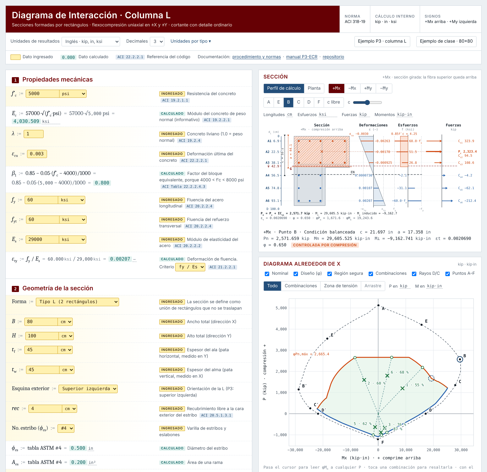

# Diagrama de Interacción · Columnas de concreto reforzado


Hoja de cálculo interactiva para construir el diagrama de interacción **P–M** de columnas de concreto reforzado, revisar combinaciones de carga y diseñar el refuerzo transversal por cortante según **ACI 318-19**. Es un solo archivo HTML, sin instalación ni dependencias. Resuelve secciones **rectangulares**, en **L** y cualquier sección formada por rectángulos.

### [▶ Abrir la hoja interactiva](https://a-terron.github.io/Diagrama-de-Interacci-n---Columnas/)



---

## Documentación

| Documento | Versión web | En GitHub | Contenido |
|---|---|---|---|
| **Hoja interactiva** | [abrir](https://a-terron.github.io/Diagrama-de-Interacci-n---Columnas/) | [`index.html`](index.html) | Entradas, puntos A–F con todas las sustituciones, diagramas en ±X y ±Y, revisión de combinaciones y cortante. |
| **Procedimiento técnico** | [leer](https://a-terron.github.io/Diagrama-de-Interacci-n---Columnas/docs/procedimiento-columna-L.html) | [Markdown](docs/procedimiento-columna-L.md) | Supuestos, tipo de análisis, procedimiento paso a paso, secciones de ACI 318-19 usadas, diferencias con la columna rectangular y validación. |
| **Manual P3-ECR** | [leer](https://a-terron.github.io/Diagrama-de-Interacci-n---Columnas/docs/manual-P3-ECR-columna-L.html) | [Markdown](docs/manual-P3-ECR-columna-L.md) | Solución completa de un examen con columna en L: cada fórmula, por qué se aplica, qué significa cada resultado y 26 figuras: el área comprimida punto por punto, cómo se construye el diagrama (puntos A′–F′ e iteraciones de $`c`$) y el cálculo de cada D/C. |
| **Manual para Obsidian** | — | [obsidian/](obsidian/) | El mismo manual con callouts, incrustaciones `![[...]]` y enlaces internos de Obsidian. |

> [!TIP]
> Las versiones web están en español y tienen las fórmulas renderizadas, así que el navegador no intenta traducirlas. Si lees el Markdown en github.com con el traductor de Chrome activado, las fórmulas pueden salir con palabras como "incógnita" (por $`x`$), "gramo" (por $`g`$) o "en" (por in). Usa la versión web, o en Chrome elige **Mostrar original** y **No traducir nunca este sitio**.

## Qué hace la hoja

- Define la sección como **unión de rectángulos** (rectangular, L o personalizada) y calcula $`A_g`$ y el centroide.
- Coloca las barras con un generador (esquinas de estribos + intermedias equidistantes) o desde una tabla de coordenadas.
- Desarrolla los puntos notables **A, E, B, C, D y F** por **compatibilidad de deformaciones**, capa por capa, como en la hoja de clase.
- Dibuja las curvas **nominal** y **de diseño** ($`\phi P_n`$, $`\phi M_n`$) en las cuatro direcciones: $`+M_x`$, $`-M_x`$, $`+M_y`$, $`-M_y`$.
- Revisa cada combinación $`(P_u, M_x, M_y)`$ con el método **radial D/C** y reporta el momento perpendicular inducido $`M_\perp`$ de las secciones asimétricas.
- Diseña el refuerzo transversal en el **eje fuerte y el eje débil** (identificados con $`I_x`$ e $`I_y`$): $`V_{pr}`$, $`V_c`$ con carga axial, $`A_v/s`$, separación máxima, soporte lateral y **eslabones** por segmento, con todos los cálculos a la vista. El procedimiento es el de las hojas de clase de Mathcad y Excel.

## Cómo usarla

1. Abre la [hoja en línea](https://a-terron.github.io/Diagrama-de-Interacci-n---Columnas/), o descarga [`index.html`](index.html) y ábrelo en cualquier navegador (funciona sin internet).
2. Carga un ejemplo con los botones **Ejemplo P3 · columna L** o **Ejemplo de clase · 80×80**.
3. Cambia los datos en las **celdas amarillas**. Todo se recalcula al instante; las celdas verdes son resultados.
4. En la vista **Perfil de cálculo** elige la dirección (±X, ±Y) y el punto (A–F o *c libre*) para ver deformaciones, esfuerzos y fuerzas alineados con la sección.
5. En los diagramas, pasa el cursor para leer $`\phi M_n`$ a cualquier $`P`$, arrastra para hacer zoom y toca una combinación para resaltarla en ambas gráficas.

La hoja recuerda los últimos datos en el mismo navegador.

## Caso de prueba: P3-ECR

Columna en L de 0.80 × 1.00 m (ala y alma de 0.45 m), $`f'_c`$ = 5,000 psi, grado 60, 18 barras.

| Resultado | Valor |
|---|---|
| Área bruta y centroide | $`A_g`$ = 941.627 in² · $`G`$ = (32.87 ; 57.13) cm |
| Armado | 8 #10 + 10 #9 = 20.16 in² · $`\rho`$ = 2.14 % |
| Capacidad axial | $`P_o`$ = 5,125.834 kip · $`\phi P_{n,máx}`$ = 2,665.434 kip · $`P_{nt}`$ = −1,209.6 kip |
| Revisión de 6 combinaciones | Todas cumplen · D/C máximo 89.6 % (caso 6, eje Y) · las 12 D/C desarrolladas paso a paso en el manual |
| Refuerzo transversal | #4 @ 9 cm: 2 estribos + 1 eslabón en el ala + 2 eslabones en el alma |

El desarrollo completo está en el [manual](https://a-terron.github.io/Diagrama-de-Interacci-n---Columnas/docs/manual-P3-ECR-columna-L.html) ([versión Markdown](docs/manual-P3-ECR-columna-L.md)).

## Alcance y limitaciones

- Columna **corta**: no incluye efectos de esbeltez.
- Flexión **uniaxial** con eje neutro paralelo al eje de flexión. En secciones asimétricas el momento perpendicular $`M_\perp`$ se reporta pero no se revisa.
- Cortante con **detalle ordinario**; no cubre la zona confinada de pórticos especiales (ACI 18.7).
- Todavía no resuelve secciones circulares con zuncho.

**Próximas versiones:** flexión biaxial (eje neutro girado), secciones circulares, formas T y C predefinidas.

## Estructura del repositorio

```text
├── index.html                        Hoja interactiva (se publica en GitHub Pages)
├── README.md                         Esta portada
├── docs/
│   ├── procedimiento-columna-L.md    Procedimiento técnico
│   ├── manual-P3-ECR-columna-L.md    Manual del P3-ECR (formato GitHub)
│   ├── *.html                        Versiones web en español de los dos documentos
│   └── img/                          Figuras SVG y captura de la hoja
├── obsidian/
│   └── Manual P3-ECR - Columna L.md  Manual del P3-ECR (formato Obsidian)
├── LICENSE
├── .gitignore
└── .nojekyll
```

## Usar el manual en Obsidian

Descarga o clona el repositorio y ábrelo como bóveda (*Open folder as vault*). También puedes copiar `obsidian/` y `docs/img/` a una bóveda existente. Obsidian encuentra las figuras por su nombre, sin importar la carpeta en la que estén.

## Aviso

Es una herramienta educativa. Antes de usar los resultados en un diseño real, verifícalos y revísalos con criterio profesional. Este repositorio no incluye el texto de ACI 318-19; solo cita sus secciones.

## Licencia

- **Código** (`index.html`): [MIT](LICENSE).
- **Documentación y figuras** (`docs/`, `obsidian/`): [CC BY 4.0](https://creativecommons.org/licenses/by/4.0/deed.es). Los datos del enunciado del examen pertenecen al curso.
