# Manual · Solución del P3-ECR con el diagrama de interacción para columnas L

> [!NOTE]
> **Curso:** Estructuras de Concreto Reforzado · Tercer Examen Parcial (2026) · ACI 318-19
>
> **Hoja interactiva:** [abrir en GitHub Pages](https://a-terron.github.io/Diagrama-de-Interacci-n---Columnas/) · **Procedimiento técnico:** [procedimiento-columna-L.md](procedimiento-columna-L.md) · **Versión para Obsidian:** [obsidian/](../obsidian/)

Este manual resuelve el Tercer Examen Parcial de Estructuras de Concreto Reforzado paso a paso, en el mismo orden que la hoja interactiva **Diagrama de Interacción · Columna L** (v5.1). En cada paso explica qué dato se usa, de dónde sale cada fórmula, por qué se hace así y qué significa el resultado. Todos los números salen del mismo motor de cálculo de la hoja.

> [!IMPORTANT]
> **Respuestas del examen**
>
> | Inciso | Resultado |
> |---|---|
> | 1 · Armado | 8 #10 (barras rojas) + 10 #9 (intermedias) = **20.16 in²** · $\rho$ = **2.14 %** (entre 1 % y 4 %) |
> | 2 · Diagramas | Cuatro ramas: $+M_x$, $-M_x$, $+M_y$, $-M_y$ con puntos A–F ([§7](#7-paso-5--inciso-2--puntos-del-diagrama-de-interacción) y Figura 10) |
> | 3 · Revisión | Las 6 combinaciones **cumplen**. D/C máximo **89.6 %** (caso 6, eje Y) |
> | 4 · Cortante | Estribos y eslabones **#4 @ 9 cm**: 2 estribos + 1 eslabón en el ala + 2 eslabones en el alma ([§10.7](#107-esquema-final-de-la-sección)) |

---

## 0. Cómo usar este manual

| Paso del manual | Sección de la hoja | Inciso |
|---|---|---|
| [Paso 1](#3-paso-1--propiedades-mecánicas) Propiedades mecánicas | 1 | — |
| [Paso 2](#4-paso-2--geometría-de-la-sección) Geometría | 2 | — |
| [Paso 3](#5-paso-3--inciso-1--propuesta-de-armado) Armado | 3 | 1 |
| [Paso 4](#6-paso-4--direcciones-de-análisis-y-capas-de-acero) Direcciones y capas | 4 | 2 |
| [Paso 5](#7-paso-5--inciso-2--puntos-del-diagrama-de-interacción) Puntos A–F | 5 | 2 |
| [Paso 6](#8-paso-6--factor-de-reducción-φ) Factor φ | 6 | 2 |
| [Paso 7](#9-paso-7--inciso-3--revisión-de-las-combinaciones) Combinaciones | 7 | 3 |
| [Paso 8](#10-paso-8--inciso-4--cortante-y-refuerzo-transversal) Cortante | 8 | 4 |

Los recuadros tienen siempre el mismo significado:

> [!NOTE]
> **Concepto**
>
> Explica la idea detrás del cálculo.

> [!NOTE]
> **Norma**
>
> Cita la sección de ACI 318-19 que se aplica.

> [!TIP]
> **En la hoja**
>
> Dice qué tocar o dónde mirar en la hoja interactiva.

> [!WARNING]
> **Cuidado**
>
> Señala errores comunes o supuestos que conviene recordar.

<b>Desarrollo numérico (plegado)</b>

Las tablas largas van plegadas. Haz clic en el título para abrirlas.

> [!IMPORTANT]
> **Respuesta**
>
> Resultado que se escribe en el examen.

**Unidades.** La hoja calcula en kip, in y ksi, como en clase. Conversiones usadas: 1 in = 2.54 cm; 1 m = 39.370 in; 1 ksi = 1,000 psi; 1 kip·in = 0.11298 kN·m.

---

## 1. El problema

Columna de concreto reforzado con sección en **L** (Figura 1):

| Dato | Valor | En unidades de cálculo |
|---|---|---|
| Concreto | $f'_c$ = 5,000 psi | 5 ksi |
| Acero longitudinal y transversal | Grado 60 | $f_y = f_{yt}$ = 60 ksi |
| Ancho total (X) | $B$ = 0.80 m | 31.496 in |
| Alto total (Y) | $H$ = 1.00 m | 39.370 in |
| Espesor del ala (horizontal) | $t_f$ = 0.45 m | 17.717 in |
| Espesor del alma (vertical) | $t_w$ = 0.45 m | 17.717 in |
| Recubrimiento | 0.04 m | 1.575 in |
| Altura total / altura libre | 6.00 m / 5.25 m | 236.22 in / 206.69 in |
| Barras | 18: 8 "rojas" + 10 intermedias | equidistantes entre rojas |

Lo que pide el examen:

1. Proponer un armado entre 1 % y 4 % de $A_g$ usando solo las 18 barras del dibujo.
2. Detallar el diagrama de interacción para momentos positivos y negativos en X y en Y.
3. Revisar 6 combinaciones $(P_u, M_x)$ y $(P_u, M_y)$ con los momentos **no simultáneos**; compresión positiva.
4. Revisar el cortante del concreto y la separación de estribos para 6 pares $(V_x, V_y)$ y dibujar la sección final.

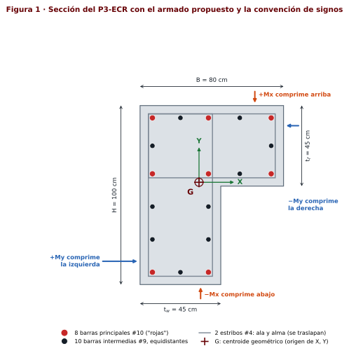

> [!NOTE]
> **Barras "rojas" y barras intermedias**
>
> Las 8 barras rojas están en las **esquinas de los estribos**: 5 en las esquinas exteriores de la L (N1, N3, N6, N7, N8), 1 en la esquina entrante (N5) y 2 donde se cruzan los dos estribos (N2 y N4). Entre cada par de barras rojas, las intermedias deben quedar a **separación uniforme**; por eso la hoja las coloca dividiendo cada tramo en partes iguales.

---

## 2. Conceptos que necesitas

### 2.1 Qué es un diagrama de interacción

Una columna casi nunca trabaja solo a compresión: recibe al mismo tiempo una carga axial $P$ y un momento $M$. El **diagrama de interacción** es la curva de todas las parejas $(M, P)$ que agotan la sección. Cada punto de la curva corresponde a una posición del **eje neutro** $c$:

- $c$ muy grande: toda la sección comprimida → mucha $P$, poco $M$ (punto A).
- $c$ intermedio: una parte comprime y otra tensiona → el mayor momento (cerca del punto B).
- $c$ pequeño: casi todo el acero en tensión → poco $P$ o tensión (puntos D y F).

La curva **nominal** $(P_n, M_n)$ es la resistencia teórica. La curva de **diseño** $(\phi P_n, \phi M_n)$ multiplica cada punto por su $\phi$ y se corta en $\phi P_{n,máx}$. Si una carga $(M_u, P_u)$ cae dentro de la curva de diseño, la columna resiste esa combinación.

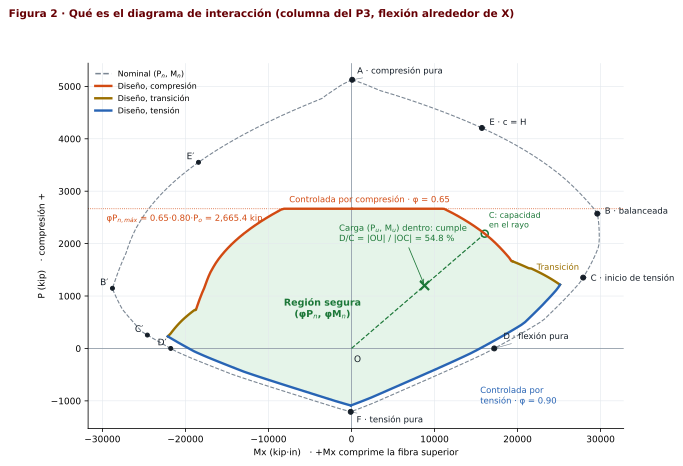

### 2.2 Hipótesis de diseño

> [!NOTE]
> **ACI 318-19, 22.2**
>
> 1. Las secciones planas permanecen planas: la deformación varía linealmente con la distancia al eje neutro (22.2.1.2).
> 2. La deformación máxima del concreto es $\varepsilon_{cu} = 0.003$ en la fibra extrema comprimida (22.2.2.1).
> 3. El concreto no resiste tensión (22.2.2.2).
> 4. El esfuerzo de compresión del concreto se reemplaza por un bloque rectangular de $0.85 f'_c$ con profundidad $a = \beta_1 c$ (22.2.2.4.1).
> 5. El acero es elastoplástico: $f_s = E_s \varepsilon_s$ hasta $f_y$ (20.2.2.1).

Además, como en clase: cada barra concentra su área en su centro, si una barra queda dentro del bloque se le resta el concreto que desplaza ($-0.85f'_c$), la columna es corta (sin esbeltez) y los momentos en X y Y se revisan por separado.

### 2.3 Convención de signos

| Magnitud | Positivo | Negativo |
|---|---|---|
| $P$ | compresión | tensión |
| $\varepsilon_s$ | tensión | compresión |
| $f_s$, $C_s$ | compresión | tensión |
| $M_x$ | comprime la fibra **superior** (ala de 0.80 m) | comprime la fibra inferior |
| $M_y$ | comprime la fibra **izquierda** (alma de 1.00 m) | comprime la fibra derecha |
| $V_x$ | cortante asociado a $M_x$ (fuerza a lo largo de Y) | |
| $V_y$ | cortante asociado a $M_y$ (fuerza a lo largo de X) | |

### 2.4 Por qué la L es distinta de la rectangular

> [!NOTE]
> **Cuatro diferencias que cambian el cálculo**
>
> 1. **El centroide no está en el centro.** Los momentos se toman respecto al centroide $G$, que en la L no está en $B/2$ ni en $H/2$. El $h/2$ de clase se convierte en $\bar v$, la profundidad de $G$ medida desde la fibra comprimida.
> 2. **El área comprimida cambia de forma.** No siempre es $b\cdot a$: depende de si el bloque ya pasó el espesor del ala o del alma (Figura 8).
> 3. **Positivo ≠ negativo.** Comprimir el ala no es lo mismo que comprimir el pie del alma, así que se calculan cuatro curvas: $\pm M_x$ y $\pm M_y$.
> 4. **Aparece un momento en la otra dirección.** Con el eje neutro paralelo a X, el centroide del concreto comprimido no queda en la misma vertical que $G$ y se genera un $M_y$ "inducido" ($M_\perp$). La hoja lo reporta pero, siguiendo el método de clase y el enunciado, no lo incluye en la revisión.

### 2.5 Ruta de solución

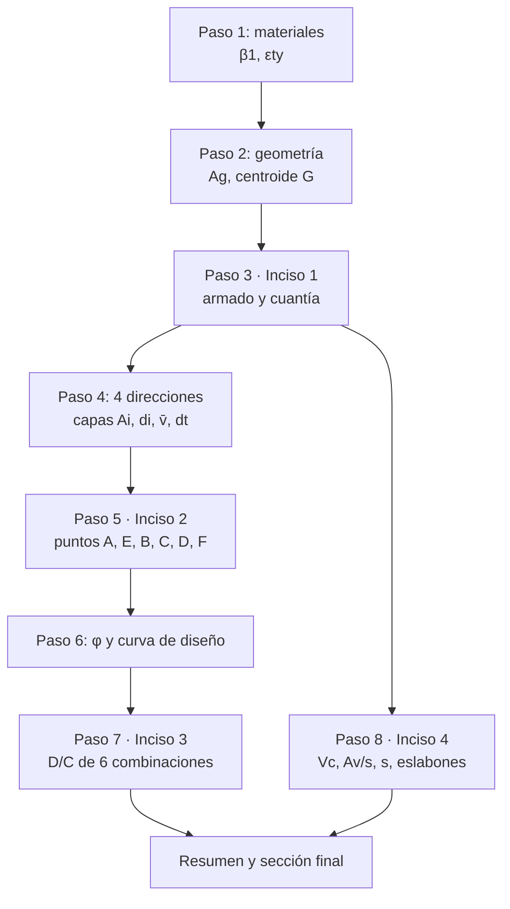

---

## 3. Paso 1 · Propiedades mecánicas

**Hoja: sección 1.** Se ingresan $f'_c$ = 5,000 psi, $f_y$ = $f_{yt}$ = 60 ksi, $E_s$ = 29,000 ksi, $\varepsilon_{cu}$ = 0.003 y $\lambda$ = 1.0 (concreto de peso normal).

**Factor del bloque $\beta_1$.** Indica qué fracción del eje neutro ocupa el bloque rectangular equivalente. Para 4,000 < $f'_c$ < 8,000 psi baja 0.05 por cada 1,000 psi:

$$\beta_1 = 0.85 - 0.05\,\frac{f'_c - 4000}{1000} = 0.85 - 0.05\,\frac{5000 - 4000}{1000} = 0.800$$

> [!NOTE]
> **ACI 318-19, Tabla 22.2.2.4.3**
>
> $\beta_1$ = 0.85 si $f'_c \le$ 4,000 psi; 0.65 si $f'_c \ge$ 8,000 psi; lineal entre ambos.

**Deformación de fluencia.** Es la deformación a la que el acero llega a $f_y$; separa el acero "elástico" del que ya fluyó:

$$\varepsilon_{ty} = \frac{f_y}{E_s} = \frac{60}{29{,}000} = 0.0020690$$

**Límite de la zona controlada por tensión** (lo usa $\phi$):

$$\varepsilon_{t,\text{tens}} = \varepsilon_{ty} + 0.003 = 0.0050690$$

**Módulo del concreto** (solo informativo, no entra en el diagrama):

$$E_c = 57{,}000\sqrt{f'_c} = 57{,}000\sqrt{5{,}000} = 4{,}030{,}509\ \text{psi} = 4{,}030.5\ \text{ksi}$$

---

## 4. Paso 2 · Geometría de la sección

**Hoja: sección 2.** Forma = *Tipo L*, $B$ = 80 cm, $H$ = 100 cm, $t_f$ = 45 cm, $t_w$ = 45 cm, esquina exterior *superior izquierda*, recubrimiento 4 cm, estribo #4.

### 4.1 La L como dos rectángulos

Se pone el origen en la esquina inferior izquierda y la L se parte en dos rectángulos que **no se traslapan**:

| Rectángulo | $x_0$ (in) | $y_0$ (in) | Ancho (in) | Alto (in) | $A_j$ (in²) | $x_j$ (in) | $y_j$ (in) |
|---|--:|--:|--:|--:|--:|--:|--:|
| R1 · ala | 0 | $H - t_f$ = 21.654 | 31.496 | 17.717 | 558.001 | 15.748 | 30.512 |
| R2 · alma bajo el ala | 0 | 0 | 17.717 | 21.654 | 383.626 | 8.858 | 10.827 |

> [!NOTE]
> **Por qué rectángulos**
>
> Con el eje neutro paralelo a X o a Y, la parte comprimida de un rectángulo siempre es otro rectángulo. Así el área comprimida y su centroide se calculan exactamente con sumas, igual que una viga T.

### 4.2 Área bruta y centroide

$$A_g = A_1 + A_2 = 558.001 + 383.626 = 941.627\ \text{in}^2 \;(0.6075\ \text{m}^2)$$

$$\bar x = \frac{A_1 x_1 + A_2 x_2}{A_g} = \frac{558.001\cdot15.748 + 383.626\cdot8.858}{941.627} = 12.941\ \text{in} = 32.87\ \text{cm}$$

$$\bar y = \frac{A_1 y_1 + A_2 y_2}{A_g} = \frac{558.001\cdot30.512 + 383.626\cdot10.827}{941.627} = 22.492\ \text{in} = 57.13\ \text{cm}$$

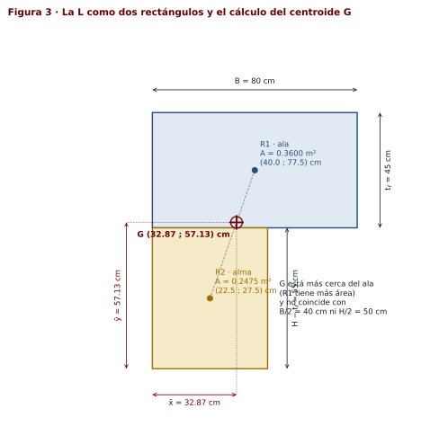

**Qué significa:** $G$ es el punto respecto al cual se suman todos los momentos. Los programas de análisis como ETABS ubican normalmente el eje del elemento en el centroide, así que los $M_u$ del enunciado se interpretan respecto a $G$.

### 4.3 Centroide plástico (verificación)

El centroide plástico es donde actúa $P_o$ cuando todo está comprimido. Con $\sum A_{si}x_i$ = 269.056 in³ y $\sum A_{si}y_i$ = 454.947 in³:

$$x_{pc} = \frac{0.85 f'_c\,(A_g\bar x - \sum A_{si}x_i) + f_y \sum A_{si}x_i}{P_o} = 13.030\ \text{in} \qquad y_{pc} = 22.508\ \text{in}$$

Queda a **0.23 cm** de $G$, así que usar uno u otro no cambia los resultados. La hoja usa $G$ por defecto (selector *Referencia de momentos*).

### 4.4 Otros datos geométricos

- Menor dimensión de la sección: $\min(t_f, t_w)$ = 17.717 in. Se usa en la separación de estribos (ACI 25.7.2.1).
- $H_c$ = 236.22 in y $l_u$ = 206.69 in. Se usan en el cortante ($l_u/c_1$).

---

## 5. Paso 3 · Inciso 1 · propuesta de armado

**Hoja: sección 3.** Barras = *Generador*, varilla principal **#10**, intermedias **#9**, ubicación *en la línea de las barras principales*.

### 5.1 Límites de cuantía

> [!NOTE]
> **ACI 318-19, 10.6.1.1**
>
> $0.01 A_g \le A_{st} \le 0.08 A_g$. El examen limita a 4 %, que además es lo recomendado para que los traslapes no congestionen la sección.

$$A_{s,1\%} = 0.01\cdot941.627 = 9.416\ \text{in}^2 \qquad A_{s,4\%} = 0.04\cdot941.627 = 37.665\ \text{in}^2$$

### 5.2 Cómo se eligió el armado

El número de barras está fijo (18), así que solo se eligen los diámetros: $A_{st} = 8\,A_{\text{roja}} + 10\,A_{\text{intermedia}}$. Un primer criterio sale de los casos en **tensión**: en tensión pura el concreto no ayuda y todo lo resiste el acero, así que para el caso 4 ($P_u$ = −880 kip):

$$\phi P_{nt} = 0.90\,f_y A_{st} \ge 880 \;\Rightarrow\; A_{st} \ge \frac{880}{0.90\cdot 60} = 16.30\ \text{in}^2$$

Como esos casos también tienen momento, hace falta algo más. Se probaron varias combinaciones en la hoja:

| Armado | $A_{st}$ (in²) | $\rho$ | $\phi P_{n,máx}$ (kip) | $\phi P_{nt}$ (kip) | D/C máx. | Controla |  |
|---|--:|--:|--:|--:|--:|---|---|
| 8 #8 + 10 #8 | 14.22 | 1.51 % | 2,493.2 | −767.9 | 121.8 % | Caso 4 (X) | no cumple |
| 8 #9 + 10 #8 | 15.90 | 1.69 % | 2,541.9 | −858.6 | 109.8 % | Caso 4 (X) | no cumple |
| 8 #9 + 10 #9 | 18.00 | 1.91 % | 2,602.8 | −972.0 | 96.3 % | Caso 4 (X) |  |
| 8 #10 + 10 #8 | 18.06 | 1.92 % | 2,604.6 | −975.2 | 97.6 % | Caso 4 (X) |  |
| 8 #10 + 10 #9 | 20.16 | 2.14 % | 2,665.4 | −1,088.6 | 89.6 % | Caso 6 (Y) | **elegida** |
| 8 #10 + 10 #10 | 22.86 | 2.43 % | 2,743.7 | −1,234.4 | 86.9 % | Caso 6 (Y) |  |
| 8 #11 + 10 #10 | 25.18 | 2.67 % | 2,811.0 | −1,359.7 | 84.7 % | Caso 6 (Y) |  |

Se eligió **8 #10 + 10 #9**: es el menor armado de la tabla con todas las combinaciones bajo 90 % (en clase se recomienda trabajar entre 85 % y 95 %).

> [!WARNING]
> **Por qué no basta con llegar al 1 %**
>
> 8 #8 + 10 #8 da 1.51 % (cumple la cuantía) pero el caso 4 llega a 122 %. La cuantía mínima es un requisito de norma; el armado lo deciden las cargas.

### 5.3 Posición de cada barra

**Recubrimiento al centro de la barra principal.** El recubrimiento de 4 cm se mide a la cara exterior del estribo; al centro de una barra #10 hay que sumar el estribo y medio diámetro:

$$REC = rec + \phi_{es} + \frac{\phi_p}{2} = 1.575 + 0.500 + \frac{1.270}{2} = 2.710\ \text{in} = 6.88\ \text{cm}$$

**Líneas de barras.** Las barras rojas están en el cruce de tres líneas verticales y tres horizontales:

$$x_a = REC = 2.710 \qquad x_b = t_w - REC = 15.007 \qquad x_c = B - REC = 28.786\ \text{in}$$

$$y_a = REC = 2.710 \qquad y_b = H - t_f + REC = 24.363 \qquad y_c = H - REC = 36.660\ \text{in}$$

| Nodo | Coordenada | Ubicación |
|---|---|---|
| N1, N2, N3 | $(x_a, y_c)$, $(x_b, y_c)$, $(x_c, y_c)$ | cara superior |
| N4, N5, N6 | $(x_a, y_b)$, $(x_b, y_b)$, $(x_c, y_b)$ | nivel inferior del ala; N5 es la esquina entrante |
| N7, N8 | $(x_a, y_a)$, $(x_b, y_a)$ | pie del alma |

**Barras intermedias equidistantes.** En un segmento entre los nodos $N_i$ y $N_j$ con $n$ barras, la barra $k$ queda en:

$$\mathbf{p}_k = \mathbf{N}_i + \frac{k}{n+1}\left(\mathbf{N}_j - \mathbf{N}_i\right), \qquad k = 1, \dots, n$$

Es decir, el tramo se divide en $n+1$ partes iguales. Por ejemplo, en s6 (de N4 a N7, $n$ = 2) la longitud es $y_b - y_a$ = 55.00 cm y la separación centro a centro es 55.00/3 = 18.33 cm.

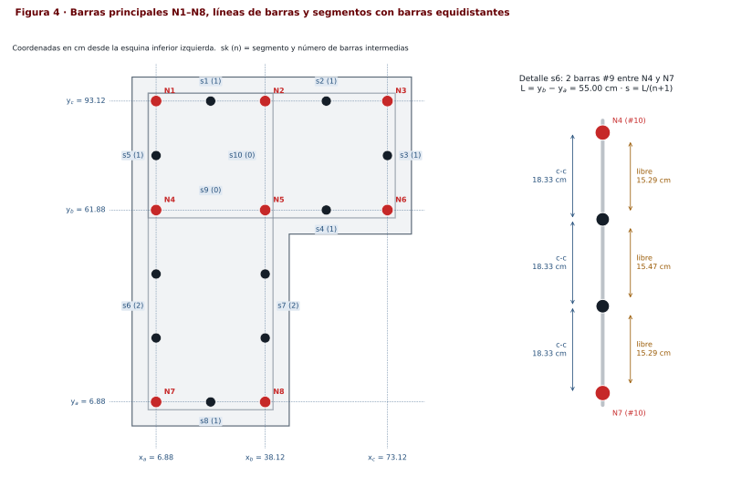

<b>Coordenadas de las 18 barras</b>

| Barra | Segmento | No. | $A$ (in²) | $x$ (in) | $y$ (in) | $x$ (cm) | $y$ (cm) |
|---|:-:|:-:|--:|--:|--:|--:|--:|
| N1 | — | #10 | 1.27 | 2.710 | 36.660 | 6.88 | 93.12 |
| N2 | — | #10 | 1.27 | 15.007 | 36.660 | 38.12 | 93.12 |
| N3 | — | #10 | 1.27 | 28.786 | 36.660 | 73.12 | 93.12 |
| N4 | — | #10 | 1.27 | 2.710 | 24.363 | 6.88 | 61.88 |
| N5 | — | #10 | 1.27 | 15.007 | 24.363 | 38.12 | 61.88 |
| N6 | — | #10 | 1.27 | 28.786 | 24.363 | 73.12 | 61.88 |
| N7 | — | #10 | 1.27 | 2.710 | 2.710 | 6.88 | 6.88 |
| N8 | — | #10 | 1.27 | 15.007 | 2.710 | 38.12 | 6.88 |
| s1-1 | s1 | #9 | 1.00 | 8.858 | 36.660 | 22.50 | 93.12 |
| s2-1 | s2 | #9 | 1.00 | 21.896 | 36.660 | 55.62 | 93.12 |
| s3-1 | s3 | #9 | 1.00 | 28.786 | 30.512 | 73.12 | 77.50 |
| s4-1 | s4 | #9 | 1.00 | 21.896 | 24.363 | 55.62 | 61.88 |
| s5-1 | s5 | #9 | 1.00 | 2.710 | 30.512 | 6.88 | 77.50 |
| s6-1 | s6 | #9 | 1.00 | 2.710 | 17.145 | 6.88 | 43.55 |
| s6-2 | s6 | #9 | 1.00 | 2.710 | 9.928 | 6.88 | 25.22 |
| s7-1 | s7 | #9 | 1.00 | 15.007 | 17.145 | 38.12 | 43.55 |
| s7-2 | s7 | #9 | 1.00 | 15.007 | 9.928 | 38.12 | 25.22 |
| s8-1 | s8 | #9 | 1.00 | 8.858 | 2.710 | 22.50 | 6.88 |

### 5.4 Revisiones del armado

$$A_{st} = 8\cdot1.27 + 10\cdot1.00 = 20.16\ \text{in}^2 \;(130.1\ \text{cm}^2) \qquad \rho = \frac{A_{st}}{A_g} = \frac{20.16}{941.627} = 2.14\ \%$$

**Separación libre por segmento.** Entre barras de columna debe haber al menos $\max(1.5\ \text{in},\ 1.5\,d_b)$ = $\max(1.5,\ 1.5\cdot1.27)$ = 1.905 in = 4.84 cm (ACI 25.2.3). La separación libre es la distancia centro a centro menos los dos radios:

$$s_{libre} = s_{cc} - \frac{d_{b1} + d_{b2}}{2}$$

| Seg. | Entre | Ubicación | $n$ | $L$ (cm) | $s_{cc}$ (cm) | Libre (cm) | Libre mín. (cm) | ¿Cabe? | Máx. $n$ | Libre vs 6 in |
|---|:-:|---|:-:|--:|--:|--:|--:|:-:|:-:|:-:|
| s1 | N1–N2 | Superior · tramo del alma | 1 | 31.23 | 15.62 | 12.57 | 4.84 | Sí | 2 | ≤ 6 in |
| s2 | N2–N3 | Superior · tramo del ala | 1 | 35.00 | 17.50 | 14.45 | 4.84 | Sí | 3 | ≤ 6 in |
| s3 | N3–N6 | Punta del ala | 1 | 31.23 | 15.62 | 12.57 | 4.84 | Sí | 2 | ≤ 6 in |
| s4 | N5–N6 | Cara inferior del ala | 1 | 35.00 | 17.50 | 14.45 | 4.84 | Sí | 3 | ≤ 6 in |
| s5 | N1–N4 | Izquierda · tramo del ala | 1 | 31.23 | 15.62 | 12.57 | 4.84 | Sí | 2 | ≤ 6 in |
| s6 | N4–N7 | Izquierda · tramo del alma | 2 | 55.00 | 18.33 | 15.29 | 4.84 | Sí | 5 | > 6 in |
| s7 | N5–N8 | Derecha del alma | 2 | 55.00 | 18.33 | 15.29 | 4.84 | Sí | 5 | > 6 in |
| s8 | N7–N8 | Inferior del alma | 1 | 31.23 | 15.62 | 12.57 | 4.84 | Sí | 2 | ≤ 6 in |
| s9 | N4–N5 | Interior horizontal | 0 | 31.23 | 31.23 | 28.01 | 4.84 | Sí | 2 | — |
| s10 | N2–N5 | Interior vertical | 0 | 31.23 | 31.23 | 28.01 | 4.84 | Sí | 2 | — |

Todas caben. La última columna se usa en el inciso 4 (soporte lateral).

> [!IMPORTANT]
> **Inciso 1**
>
> **8 #10** en las esquinas de los estribos (barras rojas) y **10 #9** intermedias equidistantes: $A_{st}$ = 20.16 in², $\rho$ = 2.14 % (cumple 1 % ≤ ρ ≤ 4 % y ACI 10.6.1.1). 18 barras ≥ 4 (ACI 10.7.3.1).

---

## 6. Paso 4 · Direcciones de análisis y capas de acero

**Hoja: sección 4** (botones $+M_x$, $-M_x$, $+M_y$, $-M_y$).

Cada dirección se define por la fibra que se comprime. Todas las profundidades se miden **desde esa fibra**:

| Dirección | Fibra comprimida | Profundidad de una barra $d_i$ | Peralte $D$ | Referencia $\bar v$ |
|---|---|---|---|---|
| $+M_x$ | superior ($y = H$) | $H - y_i$ | $H$ | $H - \bar y$ |
| $-M_x$ | inferior ($y = 0$) | $y_i$ | $H$ | $\bar y$ |
| $+M_y$ | izquierda ($x = 0$) | $x_i$ | $B$ | $\bar x$ |
| $-M_y$ | derecha ($x = B$) | $B - x_i$ | $B$ | $B - \bar x$ |

Las barras con la misma profundidad forman una **capa** $A_i$ (todas tienen la misma deformación). $d_t$ es la profundidad de la capa más alejada, la que controla $\phi$. $\bar v$ reemplaza al $h/2$ de clase: en la rectangular el centroide está a $h/2$ de cualquier cara; en la L no.

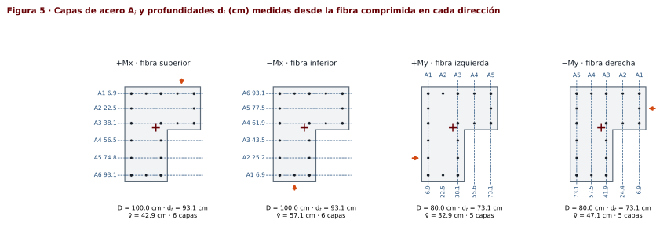

#### Capas en $+M_x$ · $D$ = 39.370 in · $d_t$ = 36.660 in · $\bar v$ = $H - \bar y$ = 39.370 − 22.492 = 16.878 in

| Capa | Barras | Cuáles | $A_{si}$ (in²) | $d_i$ (in) | $d_i$ (cm) | $\bar v-d_i$ (in) |
|---|---|---|--:|--:|--:|--:|
| A1 | 3 #10 + 2 #9 | N1, N2, N3, s1-1, s2-1 | 5.81 | 2.710 | 6.88 | 14.168 |
| A2 | 2 #9 | s3-1, s5-1 | 2.00 | 8.858 | 22.50 | 8.020 |
| A3 | 3 #10 + 1 #9 | N4, N5, N6, s4-1 | 4.81 | 15.007 | 38.12 | 1.871 |
| A4 | 2 #9 | s6-1, s7-1 | 2.00 | 22.225 | 56.45 | −5.346 |
| A5 | 2 #9 | s6-2, s7-2 | 2.00 | 29.442 | 74.78 | −12.564 |
| A6 | 2 #10 + 1 #9 | N7, N8, s8-1 | 3.54 | 36.660 | 93.12 | −19.782 |

<b>Capas en −<i>M</i>x, +<i>M</i>y y −<i>M</i>y</b>

**$-M_x$** · $D$ = 39.370 in · $d_t$ = 36.660 in · $\bar v$ = $\bar y$ = 22.492 in

| Capa | Barras | Cuáles | $A_{si}$ (in²) | $d_i$ (in) | $d_i$ (cm) | $\bar v-d_i$ (in) |
|---|---|---|--:|--:|--:|--:|
| A1 | 2 #10 + 1 #9 | N7, N8, s8-1 | 3.54 | 2.710 | 6.88 | 19.782 |
| A2 | 2 #9 | s6-2, s7-2 | 2.00 | 9.928 | 25.22 | 12.564 |
| A3 | 2 #9 | s6-1, s7-1 | 2.00 | 17.145 | 43.55 | 5.346 |
| A4 | 3 #10 + 1 #9 | N4, N5, N6, s4-1 | 4.81 | 24.363 | 61.88 | −1.871 |
| A5 | 2 #9 | s3-1, s5-1 | 2.00 | 30.512 | 77.50 | −8.020 |
| A6 | 3 #10 + 2 #9 | N1, N2, N3, s1-1, s2-1 | 5.81 | 36.660 | 93.12 | −14.168 |

**$+M_y$** · $D$ = 31.496 in · $d_t$ = 28.786 in · $\bar v$ = $\bar x$ = 12.941 in

| Capa | Barras | Cuáles | $A_{si}$ (in²) | $d_i$ (in) | $d_i$ (cm) | $\bar v-d_i$ (in) |
|---|---|---|--:|--:|--:|--:|
| A1 | 3 #10 + 3 #9 | N1, N4, N7, s5-1, s6-1, s6-2 | 6.81 | 2.710 | 6.88 | 10.231 |
| A2 | 2 #9 | s1-1, s8-1 | 2.00 | 8.858 | 22.50 | 4.083 |
| A3 | 3 #10 + 2 #9 | N2, N5, N8, s7-1, s7-2 | 5.81 | 15.007 | 38.12 | −2.066 |
| A4 | 2 #9 | s2-1, s4-1 | 2.00 | 21.896 | 55.62 | −8.955 |
| A5 | 2 #10 + 1 #9 | N3, N6, s3-1 | 3.54 | 28.786 | 73.12 | −15.845 |

**$-M_y$** · $D$ = 31.496 in · $d_t$ = 28.786 in · $\bar v$ = $B - \bar x$ = 18.555 in

| Capa | Barras | Cuáles | $A_{si}$ (in²) | $d_i$ (in) | $d_i$ (cm) | $\bar v-d_i$ (in) |
|---|---|---|--:|--:|--:|--:|
| A1 | 2 #10 + 1 #9 | N3, N6, s3-1 | 3.54 | 2.710 | 6.88 | 15.845 |
| A2 | 2 #9 | s2-1, s4-1 | 2.00 | 9.600 | 24.38 | 8.955 |
| A3 | 3 #10 + 2 #9 | N2, N5, N8, s7-1, s7-2 | 5.81 | 16.489 | 41.88 | 2.066 |
| A4 | 2 #9 | s1-1, s8-1 | 2.00 | 22.638 | 57.50 | −4.083 |
| A5 | 3 #10 + 3 #9 | N1, N4, N7, s5-1, s6-1, s6-2 | 6.81 | 28.786 | 73.12 | −10.231 |

> [!TIP]
> **En la hoja**
>
> La tabla *Resumen de las cuatro direcciones* (sección 4) muestra $D$, $d_t$, $\bar v$ y el número de capas de las cuatro direcciones juntas.

---

## 7. Paso 5 · Inciso 2 · puntos del diagrama de interacción

**Hoja: sección 5** y vista *Perfil de cálculo*.

### 7.1 Procedimiento para un eje neutro $c$

Para cualquier $c$ se hace lo mismo (Figura 7 muestra el punto B):

1. **Bloque:** $a = \min(\beta_1 c,\ D)$.
2. **Área comprimida:** de cada rectángulo $j$ (con profundidades de $v_{0j}$ a $v_{1j}$) se toma la parte entre 0 y $a$:
   $$h_j = \max\!\big(0,\ \min(v_{1j}, a) - v_{0j}\big) \qquad A_c = \sum b_j h_j \qquad v_c = \frac{\sum b_j h_j\,(v_{0j} + h_j/2)}{A_c}$$
3. **Fuerza del concreto:** $P_c = 0.85 f'_c A_c$, aplicada a la profundidad $v_c$.
4. **Artificio 1** (triángulos semejantes) en cada capa:
   $$\varepsilon_{si} = \varepsilon_{cu}\,\frac{d_i - c}{c}$$
5. **Artificio 2** (esfuerzo con el signo de clase, limitado a $f_y$):
   $$f_{si} = -\operatorname{signo}(\varepsilon_{si})\cdot\min\!\left(E_s|\varepsilon_{si}|,\ f_y\right)$$
6. **Fuerza de la capa**, restando el concreto desplazado si la capa está dentro del bloque:
   $$C_{si} = \begin{cases} A_{si}\,f_{si} & a \lt  d_i \\ A_{si}\,(f_{si} - 0.85 f'_c) & a \ge d_i\end{cases}$$
7. **Resultantes** respecto a $G$:
   $$P_n = P_c + \sum C_{si} \qquad M_n = P_c\,(\bar v - v_c) + \sum C_{si}\,(\bar v - d_i)$$
8. **Momento inducido** en la otra dirección ($u$ = coordenada a lo largo del eje neutro, $\bar u$ la de $G$):
   $$M_\perp = P_c\,(u_c - \bar u) + \sum C_{si}\,(u_i - \bar u)$$
9. **$\phi$** con $\varepsilon_t = \varepsilon_{cu}(d_t - c)/c$ ([Paso 6](#8-paso-6--factor-de-reducción-φ)).

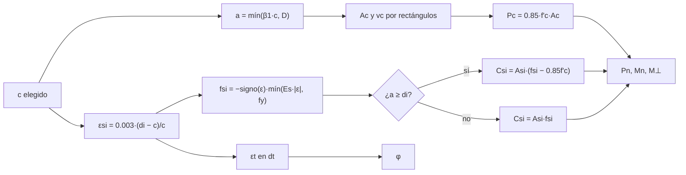

> [!NOTE]
> **Por qué $\bar v - v_c$ y $\bar v - d_i$**
>
> El momento de una fuerza respecto a $G$ es fuerza por brazo. El brazo es la distancia, medida en la dirección del análisis, entre la fuerza y $G$. Si la fuerza está más cerca de la fibra comprimida que $G$, el brazo es positivo. En la rectangular $\bar v = h/2$ y $v_c = a/2$, que es la fórmula de clase $M_n = P_c(h/2 - a/2) + \sum C_{si}(h/2 - d_i)$.

### 7.2 Área comprimida en la L

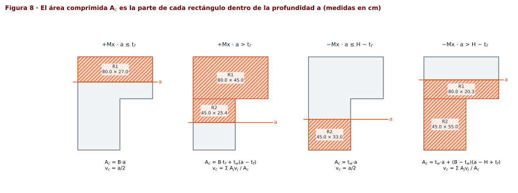

En $+M_x$ el bloque baja desde la cara superior del ala:

$$a \le t_f:\quad A_c = B\,a,\quad v_c = \frac{a}{2} \qquad\qquad a > t_f:\quad A_c = B\,t_f + t_w\,(a - t_f)$$

En $-M_x$ el bloque sube desde el pie del alma: $A_c = t_w\,a$ mientras $a \le H - t_f$, y luego se suma el ala. En $\pm M_y$ pasa lo mismo con los papeles de las patas intercambiados.

### 7.3 Desarrollo completo en $+M_x$

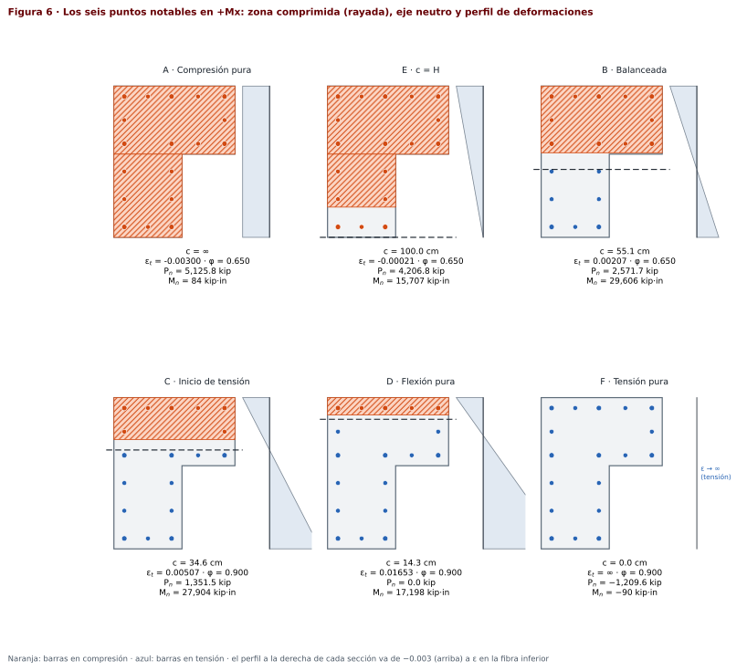

#### Punto A · compresión pura ($c \to \infty$)

Todo el concreto y todo el acero están comprimidos y fluyen:

$$P_{nA} = P_o = 0.85 f'_c\,(A_g - A_{st}) + f_y A_{st} = 0.85\cdot5\,(941.627 - 20.16) + 60\cdot20.16 = \mathbf{5{,}125.834}\ \text{kip}$$

El momento no es exactamente cero porque el acero no es simétrico respecto a $G$ (con $\bar v = v_g$, el concreto no aporta):

$$M_{nA} = \sum A_{si}(f_y - 0.85f'_c)(\bar v - d_i) = 55.75\,[5.81(14.168) + 2.00(8.020) + 4.81(1.871) + 2.00(-5.346) + 2.00(-12.564) + 3.54(-19.782)] = 84.08\ \text{kip}\cdot\text{in}$$

$M_y$ inducido = -455.1 kip·in. **Carga axial máxima** (excentricidad accidental, ACI 22.4.2.1):

$$P_{n,máx} = 0.80\,P_o = 4{,}100.667\ \text{kip} \qquad \phi P_{n,máx} = 0.65\cdot4{,}100.667 = \mathbf{2{,}665.434}\ \text{kip}$$

> [!NOTE]
> **Qué significa $\phi P_{n,máx}$**
>
> Ninguna columna con estribos puede diseñarse para más de 80 % de $P_o$, porque siempre hay alguna excentricidad accidental. Por eso la curva de diseño tiene un techo horizontal en $2{,}665.434$ kip.

#### Punto E · eje neutro igual al peralte ($c = D$)

Se toma $c = D = 39.370$ in: el eje neutro queda justo en la fibra opuesta y toda la sección está comprimida, pero la última capa casi no tiene esfuerzo.

$$a = \beta_1 c = 0.80\cdot39.370 = 31.496\ \text{in}$$

$$A_c = \sum b_j h_j = 31.496\cdot17.717 + 17.717\cdot13.780 = 802.127\ \text{in}^2 \qquad v_c = \frac{\sum A_j v_j}{A_c} = \dfrac{558.001\cdot8.858 + 244.125\cdot24.606}{802.127} = 13.651\ \text{in}$$

$$P_c = 0.85 f'_c A_c = 0.85\cdot5.0\cdot802.127 = 3{,}409.038\ \text{kip}$$

<b>Tablas del punto E en +<i>M</i>x (bloque de compresión y capas)</b>

| Rectángulo | $b_j$ (in) | $v_{0j}$ (in) | $v_{1j}$ (in) | $h_j=\min(v_{1j},a)-v_{0j}$ (in) | $A_j=b_j h_j$ (in²) | $v_j=v_{0j}+h_j/2$ (in) |
|---|--:|--:|--:|--:|--:|--:|
| R1 · ala | 31.496 | 0.000 | 17.717 | 17.717 | 558.001 | 8.858 |
| R2 · alma | 17.717 | 17.717 | 39.370 | 13.780 | 244.125 | 24.606 |
| **Σ** | | | | | **802.127** | |

| Capa | Barras | $A_{si}$ (in²) | $d_i$ (in) | $\varepsilon_{si}$ | $f_{si}$ (ksi) | ¿$a\lt d_i$? | $C_{si}$ (kip) | $\bar v-d_i$ (in) | $C_{si}(\bar v-d_i)$ (kip·in) | Estado |
|---|---|--:|--:|--:|--:|:-:|--:|--:|--:|---|
| A1 | 3 #10 + 2 #9 | 5.81 | 2.710 | −0.00279 | 60.000 | No → resta 0.85f′c | 323.908 | 14.168 | 4,589.22 | Comp. · fluye |
| A2 | 2 #9 | 2.00 | 8.858 | −0.00233 | 60.000 | No → resta 0.85f′c | 111.500 | 8.020 | 894.21 | Comp. · fluye |
| A3 | 3 #10 + 1 #9 | 4.81 | 15.007 | −0.00186 | 53.838 | No → resta 0.85f′c | 238.519 | 1.871 | 446.36 | Comp. |
| A4 | 2 #9 | 2.00 | 22.225 | −0.00131 | 37.888 | No → resta 0.85f′c | 67.276 | −5.346 | −359.69 | Comp. |
| A5 | 2 #9 | 2.00 | 29.442 | −0.00076 | 21.938 | No → resta 0.85f′c | 35.376 | −12.564 | −444.48 | Comp. |
| A6 | 2 #10 + 1 #9 | 3.54 | 36.660 | −0.00021 | 5.988 | Sí | 21.198 | −19.782 | −419.34 | Comp. |
| **Σ** | | **20.16** | | | | | **797.777** | | **4,706.27** | |

$$P_{nE} = P_c + \sum C_{si} = 3{,}409.038 + 797.777 = \mathbf{4{,}206.815}\ \text{kip}$$

$$M_{nE} = P_c(\bar v - v_c) + \sum C_{si}(\bar v - d_i) = 3{,}409.038\,(16.878 - 13.651) + 4{,}706.27 = \mathbf{15{,}707.1}\ \text{kip}\cdot\text{in}$$

$$M_y^{\text{inducido}} = -3{,}971.0\ \text{kip}\cdot\text{in} \quad (25.3\ \%\ \text{de } M_x)$$

$$\varepsilon_t = \varepsilon_{cu}\frac{d_t - c}{c} = 0.003\,\frac{36.660 - 39.370}{39.370} = -0.00021 \;\Rightarrow\; \phi = 0.65 \quad (\varepsilon_t = -0.00021 \le \varepsilon_{ty})$$

$$\phi P_n = 0.6500\cdot4{,}206.815 = 2{,}734.430\ \text{kip}\ \rightarrow\ \phi P_{n,máx} = 2{,}665.434 \qquad \phi M_x = 0.6500\cdot(15{,}707.1) = 10{,}209.6\ \text{kip}\cdot\text{in}$$

Zona: **controlada por compresión**.

#### Punto B · condición balanceada

La condición balanceada es cuando el concreto llega a $\varepsilon_{cu}$ y la capa extrema a tensión llega justo a la fluencia. Por triángulos semejantes:

$$c_b = \frac{\varepsilon_{cu}\,d_t}{\varepsilon_{cu} + \varepsilon_{ty}} = \frac{0.003\cdot36.660}{0.003 + 0.0020690} = 21.697\ \text{in}$$

$$a = \beta_1 c = 0.80\cdot21.697 = 17.358\ \text{in}$$

$$A_c = \sum b_j h_j = 31.496\cdot17.358 = 546.693\ \text{in}^2 \qquad v_c = \frac{\sum A_j v_j}{A_c} = \dfrac{546.693\cdot8.679}{546.693} = 8.679\ \text{in}$$

$$P_c = 0.85 f'_c A_c = 0.85\cdot5.0\cdot546.693 = 2{,}323.447\ \text{kip}$$

<b>Tablas del punto B en +<i>M</i>x (bloque de compresión y capas)</b>

| Rectángulo | $b_j$ (in) | $v_{0j}$ (in) | $v_{1j}$ (in) | $h_j=\min(v_{1j},a)-v_{0j}$ (in) | $A_j=b_j h_j$ (in²) | $v_j=v_{0j}+h_j/2$ (in) |
|---|--:|--:|--:|--:|--:|--:|
| R1 · ala | 31.496 | 0.000 | 17.717 | 17.358 | 546.693 | 8.679 |
| R2 · alma | 17.717 | 17.717 | 39.370 | 0.000 | 0.000 | — |
| **Σ** | | | | | **546.693** | |

| Capa | Barras | $A_{si}$ (in²) | $d_i$ (in) | $\varepsilon_{si}$ | $f_{si}$ (ksi) | ¿$a\lt d_i$? | $C_{si}$ (kip) | $\bar v-d_i$ (in) | $C_{si}(\bar v-d_i)$ (kip·in) | Estado |
|---|---|--:|--:|--:|--:|:-:|--:|--:|--:|---|
| A1 | 3 #10 + 2 #9 | 5.81 | 2.710 | −0.00263 | 60.000 | No → resta 0.85f′c | 323.908 | 14.168 | 4,589.22 | Comp. · fluye |
| A2 | 2 #9 | 2.00 | 8.858 | −0.00178 | 51.480 | No → resta 0.85f′c | 94.460 | 8.020 | 757.56 | Comp. |
| A3 | 3 #10 + 1 #9 | 4.81 | 15.007 | −0.00093 | 26.826 | No → resta 0.85f′c | 108.591 | 1.871 | 203.21 | Comp. |
| A4 | 2 #9 | 2.00 | 22.225 | 0.0000730 | −2.116 | Sí | −4.232 | −5.346 | 22.63 | Tens. |
| A5 | 2 #9 | 2.00 | 29.442 | 0.00107 | −31.058 | Sí | −62.116 | −12.564 | 780.44 | Tens. |
| A6 | 2 #10 + 1 #9 | 3.54 | 36.660 | 0.00207 | −60.000 | Sí | −212.400 | −19.782 | 4,201.73 | Tens. · fluye |
| **Σ** | | **20.16** | | | | | **248.212** | | **10,554.79** | |

$$P_{nB} = P_c + \sum C_{si} = 2{,}323.447 + 248.212 = \mathbf{2{,}571.659}\ \text{kip}$$

$$M_{nB} = P_c(\bar v - v_c) + \sum C_{si}(\bar v - d_i) = 2{,}323.447\,(16.878 - 8.679) + 10{,}554.79 = \mathbf{29{,}605.5}\ \text{kip}\cdot\text{in}$$

$$M_y^{\text{inducido}} = -9{,}162.7\ \text{kip}\cdot\text{in} \quad (30.9\ \%\ \text{de } M_x)$$

$$\varepsilon_t = \varepsilon_{cu}\frac{d_t - c}{c} = 0.003\,\frac{36.660 - 21.697}{21.697} = 0.00207 \;\Rightarrow\; \phi = 0.65 \quad (\varepsilon_t = 0.00207 \le \varepsilon_{ty})$$

$$\phi P_n = 0.6500\cdot2{,}571.659 = 1{,}671.578\ \text{kip} \qquad \phi M_x = 0.6500\cdot(29{,}605.5) = 19{,}243.6\ \text{kip}\cdot\text{in}$$

Zona: **controlada por compresión**.

<b>Cálculo de tres capas del punto B, paso a paso</b>

**A1** ($d_1$ = 2.710 in, comprimida y dentro del bloque):
$$\varepsilon_{s1} = 0.003\,\frac{2.710 - 21.697}{21.697} = -0.00263 \qquad E_s|\varepsilon| = 29{,}000\cdot|\varepsilon| = 76.13 > 60 \Rightarrow f_{s1} = +60\ \text{ksi (fluye)}$$
$$a = 17.358 \ge d_1 \Rightarrow C_{s1} = 5.81\,(60 - 0.85\cdot5) = 323.908\ \text{kip}$$

**A4** ($d_4$ = 22.225 in, justo debajo del eje neutro):
$$\varepsilon_{s4} = 0.003\,\frac{22.225 - 21.697}{21.697} = 0.0000730 \Rightarrow f_{s4} = -29{,}000\cdot0.0000730 = -2.116\ \text{ksi} \qquad C_{s4} = 2.00\cdot(-2.116) = -4.232\ \text{kip}$$

**A6** ($d_6 = d_t$ = 36.660 in, capa extrema a tensión):
$$\varepsilon_{s6} = 0.003\,\frac{36.660 - 21.697}{21.697} = 0.00207 = \varepsilon_{ty} \Rightarrow f_{s6} = -60\ \text{ksi} \qquad C_{s6} = 3.54\cdot(-60) = -212.400\ \text{kip}$$

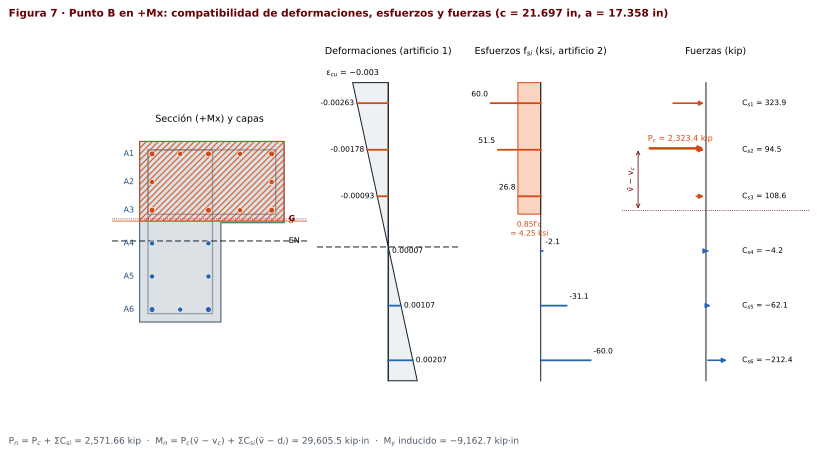

> [!NOTE]
> **De dónde sale el $M_y$ inducido en B**
>
> El bloque de B solo ocupa el ala, cuyo centroide está en $x_c$ = 15.748 in, a la derecha de $\bar x$ = 12.941 in. Solo el concreto aporta $P_c(\bar x - x_c) = 2{,}323.447\,(12.941 - 15.748) = -6{,}521.8$ kip·in; el acero aporta $-2{,}641.0$ kip·in. Total: $-9{,}162.7$ kip·in, casi un tercio de $M_x$. Es la razón de la advertencia del [§2.4](#24-por-qué-la-l-es-distinta-de-la-rectangular).

#### Punto C · inicio de la zona controlada por tensión

El punto C es donde empieza la zona controlada por tensión ($\varepsilon_t = \varepsilon_{ty} + 0.003$):

$$c = \frac{\varepsilon_{cu}\,d_t}{\varepsilon_{cu} + \varepsilon_{ty} + 0.003} = \frac{0.003\cdot36.660}{0.003 + 0.0050690} = 13.630\ \text{in}$$

$$a = \beta_1 c = 0.80\cdot13.630 = 10.904\ \text{in}$$

$$A_c = \sum b_j h_j = 31.496\cdot10.904 = 343.436\ \text{in}^2 \qquad v_c = \frac{\sum A_j v_j}{A_c} = \dfrac{343.436\cdot5.452}{343.436} = 5.452\ \text{in}$$

$$P_c = 0.85 f'_c A_c = 0.85\cdot5.0\cdot343.436 = 1{,}459.602\ \text{kip}$$

<b>Tablas del punto C en +<i>M</i>x (bloque de compresión y capas)</b>

| Rectángulo | $b_j$ (in) | $v_{0j}$ (in) | $v_{1j}$ (in) | $h_j=\min(v_{1j},a)-v_{0j}$ (in) | $A_j=b_j h_j$ (in²) | $v_j=v_{0j}+h_j/2$ (in) |
|---|--:|--:|--:|--:|--:|--:|
| R1 · ala | 31.496 | 0.000 | 17.717 | 10.904 | 343.436 | 5.452 |
| R2 · alma | 17.717 | 17.717 | 39.370 | 0.000 | 0.000 | — |
| **Σ** | | | | | **343.436** | |

| Capa | Barras | $A_{si}$ (in²) | $d_i$ (in) | $\varepsilon_{si}$ | $f_{si}$ (ksi) | ¿$a\lt d_i$? | $C_{si}$ (kip) | $\bar v-d_i$ (in) | $C_{si}(\bar v-d_i)$ (kip·in) | Estado |
|---|---|--:|--:|--:|--:|:-:|--:|--:|--:|---|
| A1 | 3 #10 + 2 #9 | 5.81 | 2.710 | −0.00240 | 60.000 | No → resta 0.85f′c | 323.908 | 14.168 | 4,589.22 | Comp. · fluye |
| A2 | 2 #9 | 2.00 | 8.858 | −0.00105 | 30.458 | No → resta 0.85f′c | 52.417 | 8.020 | 420.37 | Comp. |
| A3 | 3 #10 + 1 #9 | 4.81 | 15.007 | 0.00030 | −8.787 | Sí | −42.265 | 1.871 | −79.09 | Tens. |
| A4 | 2 #9 | 2.00 | 22.225 | 0.00189 | −54.858 | Sí | −109.716 | −5.346 | 586.59 | Tens. |
| A5 | 2 #9 | 2.00 | 29.442 | 0.00348 | −60.000 | Sí | −120.000 | −12.564 | 1,507.72 | Tens. · fluye |
| A6 | 2 #10 + 1 #9 | 3.54 | 36.660 | 0.00507 | −60.000 | Sí | −212.400 | −19.782 | 4,201.73 | Tens. · fluye |
| **Σ** | | **20.16** | | | | | **−108.057** | | **11,226.54** | |

$$P_{nC} = P_c + \sum C_{si} = 1{,}459.602 + (-108.057) = \mathbf{1{,}351.545}\ \text{kip}$$

$$M_{nC} = P_c(\bar v - v_c) + \sum C_{si}(\bar v - d_i) = 1{,}459.602\,(16.878 - 5.452) + 11{,}226.54 = \mathbf{27{,}904.0}\ \text{kip}\cdot\text{in}$$

$$M_y^{\text{inducido}} = -6{,}700.2\ \text{kip}\cdot\text{in} \quad (24.0\ \%\ \text{de } M_x)$$

$$\varepsilon_t = \varepsilon_{cu}\frac{d_t - c}{c} = 0.003\,\frac{36.660 - 13.630}{13.630} = 0.00507 \;\Rightarrow\; \phi = 0.90 \quad (\varepsilon_t = 0.00507 \ge 0.00507)$$

$$\phi P_n = 0.9000\cdot1{,}351.545 = 1{,}216.390\ \text{kip} \qquad \phi M_x = 0.9000\cdot(27{,}904.0) = 25{,}113.6\ \text{kip}\cdot\text{in}$$

Zona: **controlada por tensión**.

#### Punto D · flexión pura

En flexión pura $P_n = 0$. No hay fórmula directa para $c$, así que la hoja lo busca por **bisección**: prueba un $c$, calcula $P_n(c)$; si sale positivo (sobra compresión) baja $c$, si sale negativo lo sube. Tras 48 iteraciones:

$$P_n(c) = 0 \;\Rightarrow\; c = 5.632\ \text{in}$$

$$a = \beta_1 c = 0.80\cdot5.632 = 4.506\ \text{in}$$

$$A_c = \sum b_j h_j = 31.496\cdot4.506 = 141.907\ \text{in}^2 \qquad v_c = \frac{\sum A_j v_j}{A_c} = \dfrac{141.907\cdot2.253}{141.907} = 2.253\ \text{in}$$

$$P_c = 0.85 f'_c A_c = 0.85\cdot5.0\cdot141.907 = 603.106\ \text{kip}$$

<b>Tablas del punto D en +<i>M</i>x (bloque de compresión y capas)</b>

| Rectángulo | $b_j$ (in) | $v_{0j}$ (in) | $v_{1j}$ (in) | $h_j=\min(v_{1j},a)-v_{0j}$ (in) | $A_j=b_j h_j$ (in²) | $v_j=v_{0j}+h_j/2$ (in) |
|---|--:|--:|--:|--:|--:|--:|
| R1 · ala | 31.496 | 0.000 | 17.717 | 4.506 | 141.907 | 2.253 |
| R2 · alma | 17.717 | 17.717 | 39.370 | 0.000 | 0.000 | — |
| **Σ** | | | | | **141.907** | |

| Capa | Barras | $A_{si}$ (in²) | $d_i$ (in) | $\varepsilon_{si}$ | $f_{si}$ (ksi) | ¿$a\lt d_i$? | $C_{si}$ (kip) | $\bar v-d_i$ (in) | $C_{si}(\bar v-d_i)$ (kip·in) | Estado |
|---|---|--:|--:|--:|--:|:-:|--:|--:|--:|---|
| A1 | 3 #10 + 2 #9 | 5.81 | 2.710 | −0.00156 | 45.140 | No → resta 0.85f′c | 237.571 | 14.168 | 3,365.98 | Comp. |
| A2 | 2 #9 | 2.00 | 8.858 | 0.00172 | −49.839 | Sí | −99.678 | 8.020 | −799.40 | Tens. |
| A3 | 3 #10 + 1 #9 | 4.81 | 15.007 | 0.00499 | −60.000 | Sí | −288.600 | 1.871 | −540.08 | Tens. · fluye |
| A4 | 2 #9 | 2.00 | 22.225 | 0.00884 | −60.000 | Sí | −120.000 | −5.346 | 641.58 | Tens. · fluye |
| A5 | 2 #9 | 2.00 | 29.442 | 0.01268 | −60.000 | Sí | −120.000 | −12.564 | 1,507.72 | Tens. · fluye |
| A6 | 2 #10 + 1 #9 | 3.54 | 36.660 | 0.01653 | −60.000 | Sí | −212.400 | −19.782 | 4,201.73 | Tens. · fluye |
| **Σ** | | **20.16** | | | | | **−603.106** | | **8,377.54** | |

$$P_{nD} = P_c + \sum C_{si} = 603.106 + (-603.106) = \mathbf{0.000}\ \text{kip}$$

$$M_{nD} = P_c(\bar v - v_c) + \sum C_{si}(\bar v - d_i) = 603.106\,(16.878 - 2.253) + 8{,}377.54 = \mathbf{17{,}198.2}\ \text{kip}\cdot\text{in}$$

$$M_y^{\text{inducido}} = -2{,}735.7\ \text{kip}\cdot\text{in} \quad (15.9\ \%\ \text{de } M_x)$$

$$\varepsilon_t = \varepsilon_{cu}\frac{d_t - c}{c} = 0.003\,\frac{36.660 - 5.632}{5.632} = 0.01653 \;\Rightarrow\; \phi = 0.90 \quad (\varepsilon_t = 0.01653 \ge 0.00507)$$

$$\phi P_n = 0.9000\cdot0.000 = 0.000\ \text{kip} \qquad \phi M_x = 0.9000\cdot(17{,}198.2) = 15{,}478.3\ \text{kip}\cdot\text{in}$$

Zona: **controlada por tensión**.

#### Punto F · tensión pura ($c \le 0$)

El concreto no resiste tensión y todo el acero fluye:

$$P_{nF} = -f_y A_{st} = -60\cdot20.16 = \mathbf{-1{,}209.600}\ \text{kip} \qquad \phi P_{nF} = 0.90\cdot(-1{,}209.600) = -1{,}088.640\ \text{kip}$$

$$M_{nF} = \sum(-f_y A_{si})(\bar v - d_i) = -90.49\ \text{kip}\cdot\text{in}$$

#### Resumen de la rama +Mx

| Punto | $c$ (in) | $a$ (in) | $P_n$ (kip) | $M_n$ (kip·in) | $M_\perp$ (kip·in) | $\varepsilon_t$ | $\phi$ | $\phi P_n$ (kip) | $\phi M_n$ (kip·in) |
|---|--:|--:|--:|--:|--:|--:|--:|--:|--:|
| **A** | ∞ | 39.370 | 5,125.834 | 84.082 | −455.108 | −0.00300 | 0.650 | 2,665.434 | 54.653 |
| **E** | 39.370 | 31.496 | 4,206.815 | 15,707.074 | −3,971.013 | −0.00021 | 0.650 | 2,665.434 | 10,209.598 |
| **B** | 21.697 | 17.358 | 2,571.659 | 29,605.525 | −9,162.741 | 0.00207 | 0.650 | 1,671.578 | 19,243.591 |
| **C** | 13.630 | 10.904 | 1,351.545 | 27,904.035 | −6,700.213 | 0.00507 | 0.900 | 1,216.390 | 25,113.631 |
| **D** | 5.632 | 4.506 | 0.000 | 17,198.161 | −2,735.700 | 0.01653 | 0.900 | 0.000 | 15,478.345 |
| **F** | 0.000 | 0.000 | −1,209.600 | −90.492 | 489.802 | ∞ | 0.900 | −1,088.640 | −81.443 |

### 7.4 Las otras tres direcciones

Se repite exactamente lo mismo con las capas de cada dirección. Los puntos B y D están desarrollados en los recuadros plegados.

#### $-M_x$ · compresión en la fibra inferior

$D = 39.370$ in · $d_t = 36.660$ in · $\bar v = 22.492$ in · 6 capas

| Punto | $c$ (in) | $a$ (in) | $P_n$ (kip) | $M_n$ (kip·in) | $M_\perp$ (kip·in) | $\varepsilon_t$ | $\phi$ | $\phi P_n$ (kip) | $\phi M_n$ (kip·in) |
|---|--:|--:|--:|--:|--:|--:|--:|--:|--:|
| **A** | ∞ | 39.370 | 5,125.834 | 84.082 | −455.108 | −0.00300 | 0.650 | 2,665.434 | 54.653 |
| **E** | 39.370 | 31.496 | 3,550.998 | −18,425.697 | 3,871.341 | −0.00021 | 0.650 | 2,308.149 | −11,976.703 |
| **B** | 21.697 | 17.358 | 1,147.459 | −28,788.179 | 7,882.729 | 0.00207 | 0.650 | 745.848 | −18,712.316 |
| **C** | 13.630 | 10.904 | 255.069 | −24,582.988 | 6,469.786 | 0.00507 | 0.900 | 229.562 | −22,124.689 |
| **D** | 10.775 | 8.620 | 0.000 | −21,768.361 | 5,428.385 | 0.00721 | 0.900 | 0.000 | −19,591.525 |
| **F** | 0.000 | 0.000 | −1,209.600 | −90.492 | 489.802 | ∞ | 0.900 | −1,088.640 | −81.443 |

<b>Desarrollo del punto B en −<i>M</i>x</b>

$c_b = \dfrac{0.003\cdot36.660}{0.003 + 0.0020690} = 21.697$ in.

$$a = \beta_1 c = 0.80\cdot21.697 = 17.358\ \text{in}$$

$$A_c = \sum b_j h_j = 17.717\cdot17.358 = 307.515\ \text{in}^2 \qquad v_c = \frac{\sum A_j v_j}{A_c} = \dfrac{307.515\cdot8.679}{307.515} = 8.679\ \text{in}$$

$$P_c = 0.85 f'_c A_c = 0.85\cdot5.0\cdot307.515 = 1{,}306.939\ \text{kip}$$

<b>Tablas del punto B en −<i>M</i>x (bloque de compresión y capas)</b>

| Rectángulo | $b_j$ (in) | $v_{0j}$ (in) | $v_{1j}$ (in) | $h_j=\min(v_{1j},a)-v_{0j}$ (in) | $A_j=b_j h_j$ (in²) | $v_j=v_{0j}+h_j/2$ (in) |
|---|--:|--:|--:|--:|--:|--:|
| R1 · ala | 31.496 | 21.654 | 39.370 | 0.000 | 0.000 | — |
| R2 · alma | 17.717 | 0.000 | 21.654 | 17.358 | 307.515 | 8.679 |
| **Σ** | | | | | **307.515** | |

| Capa | Barras | $A_{si}$ (in²) | $d_i$ (in) | $\varepsilon_{si}$ | $f_{si}$ (ksi) | ¿$a\lt d_i$? | $C_{si}$ (kip) | $\bar v-d_i$ (in) | $C_{si}(\bar v-d_i)$ (kip·in) | Estado |
|---|---|--:|--:|--:|--:|:-:|--:|--:|--:|---|
| A1 | 2 #10 + 1 #9 | 3.54 | 2.710 | −0.00263 | 60.000 | No → resta 0.85f′c | 197.355 | 19.782 | 3,904.11 | Comp. · fluye |
| A2 | 2 #9 | 2.00 | 9.928 | −0.00163 | 47.192 | No → resta 0.85f′c | 85.884 | 12.564 | 1,079.08 | Comp. |
| A3 | 2 #9 | 2.00 | 17.145 | −0.00063 | 18.250 | No → resta 0.85f′c | 28.000 | 5.346 | 149.70 | Comp. |
| A4 | 3 #10 + 1 #9 | 4.81 | 24.363 | 0.00037 | −10.692 | Sí | −51.428 | −1.871 | 96.24 | Tens. |
| A5 | 2 #9 | 2.00 | 30.512 | 0.00122 | −35.346 | Sí | −70.692 | −8.020 | 566.94 | Tens. |
| A6 | 3 #10 + 2 #9 | 5.81 | 36.660 | 0.00207 | −60.000 | Sí | −348.600 | −14.168 | 4,939.07 | Tens. · fluye |
| **Σ** | | **20.16** | | | | | **−159.480** | | **10,735.14** | |

$$P_{nB} = P_c + \sum C_{si} = 1{,}306.939 + (-159.480) = \mathbf{1{,}147.459}\ \text{kip}$$

$$M_{nB} = P_c(\bar v - v_c) + \sum C_{si}(\bar v - d_i) = 1{,}306.939\,(22.492 - 8.679) + 10{,}735.14 = \mathbf{28{,}788.2}\ \text{kip}\cdot\text{in}$$

Como la compresión está en la fibra inferior, el momento con signo global es $M_x = -M_{nB} = -28{,}788.2$ kip·in.

$$M_y^{\text{inducido}} = 7{,}882.7\ \text{kip}\cdot\text{in} \quad (27.4\ \%\ \text{de } M_x)$$

$$\varepsilon_t = \varepsilon_{cu}\frac{d_t - c}{c} = 0.003\,\frac{36.660 - 21.697}{21.697} = 0.00207 \;\Rightarrow\; \phi = 0.65 \quad (\varepsilon_t = 0.00207 \le \varepsilon_{ty})$$

$$\phi P_n = 0.6500\cdot1{,}147.459 = 745.848\ \text{kip} \qquad \phi M_x = 0.6500\cdot(-28{,}788.2) = -18{,}712.3\ \text{kip}\cdot\text{in}$$

Zona: **controlada por compresión**.

<b>Desarrollo del punto D en −<i>M</i>x</b>

Bisección: $P_n(c) = 0$ con $c = 10.775$ in (50 iteraciones).

$$a = \beta_1 c = 0.80\cdot10.775 = 8.620\ \text{in}$$

$$A_c = \sum b_j h_j = 17.717\cdot8.620 = 152.715\ \text{in}^2 \qquad v_c = \frac{\sum A_j v_j}{A_c} = \dfrac{152.715\cdot4.310}{152.715} = 4.310\ \text{in}$$

$$P_c = 0.85 f'_c A_c = 0.85\cdot5.0\cdot152.715 = 649.039\ \text{kip}$$

<b>Tablas del punto D en −<i>M</i>x (bloque de compresión y capas)</b>

| Rectángulo | $b_j$ (in) | $v_{0j}$ (in) | $v_{1j}$ (in) | $h_j=\min(v_{1j},a)-v_{0j}$ (in) | $A_j=b_j h_j$ (in²) | $v_j=v_{0j}+h_j/2$ (in) |
|---|--:|--:|--:|--:|--:|--:|
| R1 · ala | 31.496 | 21.654 | 39.370 | 0.000 | 0.000 | — |
| R2 · alma | 17.717 | 0.000 | 21.654 | 8.620 | 152.715 | 4.310 |
| **Σ** | | | | | **152.715** | |

| Capa | Barras | $A_{si}$ (in²) | $d_i$ (in) | $\varepsilon_{si}$ | $f_{si}$ (ksi) | ¿$a\lt d_i$? | $C_{si}$ (kip) | $\bar v-d_i$ (in) | $C_{si}(\bar v-d_i)$ (kip·in) | Estado |
|---|---|--:|--:|--:|--:|:-:|--:|--:|--:|---|
| A1 | 2 #10 + 1 #9 | 3.54 | 2.710 | −0.00225 | 60.000 | No → resta 0.85f′c | 197.355 | 19.782 | 3,904.11 | Comp. · fluye |
| A2 | 2 #9 | 2.00 | 9.928 | −0.00024 | 6.841 | Sí | 13.682 | 12.564 | 171.90 | Comp. |
| A3 | 2 #9 | 2.00 | 17.145 | 0.00177 | −51.438 | Sí | −102.876 | 5.346 | −550.03 | Tens. |
| A4 | 3 #10 + 1 #9 | 4.81 | 24.363 | 0.00378 | −60.000 | Sí | −288.600 | −1.871 | 540.08 | Tens. · fluye |
| A5 | 2 #9 | 2.00 | 30.512 | 0.00550 | −60.000 | Sí | −120.000 | −8.020 | 962.38 | Tens. · fluye |
| A6 | 3 #10 + 2 #9 | 5.81 | 36.660 | 0.00721 | −60.000 | Sí | −348.600 | −14.168 | 4,939.07 | Tens. · fluye |
| **Σ** | | **20.16** | | | | | **−649.039** | | **9,967.51** | |

$$P_{nD} = P_c + \sum C_{si} = 649.039 + (-649.039) = \mathbf{0.000}\ \text{kip}$$

$$M_{nD} = P_c(\bar v - v_c) + \sum C_{si}(\bar v - d_i) = 649.039\,(22.492 - 4.310) + 9{,}967.51 = \mathbf{21{,}768.4}\ \text{kip}\cdot\text{in}$$

Como la compresión está en la fibra inferior, el momento con signo global es $M_x = -M_{nD} = -21{,}768.4$ kip·in.

$$M_y^{\text{inducido}} = 5{,}428.4\ \text{kip}\cdot\text{in} \quad (24.9\ \%\ \text{de } M_x)$$

$$\varepsilon_t = \varepsilon_{cu}\frac{d_t - c}{c} = 0.003\,\frac{36.660 - 10.775}{10.775} = 0.00721 \;\Rightarrow\; \phi = 0.90 \quad (\varepsilon_t = 0.00721 \ge 0.00507)$$

$$\phi P_n = 0.9000\cdot0.000 = 0.000\ \text{kip} \qquad \phi M_x = 0.9000\cdot(-21{,}768.4) = -19{,}591.5\ \text{kip}\cdot\text{in}$$

Zona: **controlada por tensión**.

#### $+M_y$ · compresión en la fibra izquierda

$D = 31.496$ in · $d_t = 28.786$ in · $\bar v = 12.941$ in · 5 capas

| Punto | $c$ (in) | $a$ (in) | $P_n$ (kip) | $M_n$ (kip·in) | $M_\perp$ (kip·in) | $\varepsilon_t$ | $\phi$ | $\phi P_n$ (kip) | $\phi M_n$ (kip·in) |
|---|--:|--:|--:|--:|--:|--:|--:|--:|--:|
| **A** | ∞ | 31.496 | 5,125.834 | −455.108 | 84.082 | −0.00300 | 0.650 | 2,665.434 | −295.820 |
| **E** | 31.496 | 25.197 | 4,329.740 | 10,332.105 | −5,299.500 | −0.00026 | 0.650 | 2,665.434 | 6,715.868 |
| **B** | 17.037 | 13.629 | 2,533.395 | 21,847.595 | −9,764.675 | 0.00207 | 0.650 | 1,646.706 | 14,200.937 |
| **C** | 10.703 | 8.562 | 1,306.592 | 21,273.524 | −6,794.705 | 0.00507 | 0.900 | 1,175.932 | 19,146.171 |
| **D** | 4.462 | 3.570 | 0.000 | 13,418.045 | −3,083.733 | 0.01635 | 0.900 | 0.000 | 12,076.241 |
| **F** | 0.000 | 0.000 | −1,209.600 | 489.802 | −90.492 | ∞ | 0.900 | −1,088.640 | 440.822 |

<b>Desarrollo del punto B en +<i>M</i>y</b>

$c_b = \dfrac{0.003\cdot28.786}{0.003 + 0.0020690} = 17.037$ in.

$$a = \beta_1 c = 0.80\cdot17.037 = 13.629\ \text{in}$$

$$A_c = \sum b_j h_j = 17.717\cdot13.629 + 21.654\cdot13.629 = 536.591\ \text{in}^2 \qquad v_c = \frac{\sum A_j v_j}{A_c} = \dfrac{241.466\cdot6.815 + 295.125\cdot6.815}{536.591} = 6.815\ \text{in}$$

$$P_c = 0.85 f'_c A_c = 0.85\cdot5.0\cdot536.591 = 2{,}280.512\ \text{kip}$$

<b>Tablas del punto B en +<i>M</i>y (bloque de compresión y capas)</b>

| Rectángulo | $b_j$ (in) | $v_{0j}$ (in) | $v_{1j}$ (in) | $h_j=\min(v_{1j},a)-v_{0j}$ (in) | $A_j=b_j h_j$ (in²) | $v_j=v_{0j}+h_j/2$ (in) |
|---|--:|--:|--:|--:|--:|--:|
| R1 · ala | 17.717 | 0.000 | 31.496 | 13.629 | 241.466 | 6.815 |
| R2 · alma | 21.654 | 0.000 | 17.717 | 13.629 | 295.125 | 6.815 |
| **Σ** | | | | | **536.591** | |

| Capa | Barras | $A_{si}$ (in²) | $d_i$ (in) | $\varepsilon_{si}$ | $f_{si}$ (ksi) | ¿$a\lt d_i$? | $C_{si}$ (kip) | $\bar v-d_i$ (in) | $C_{si}(\bar v-d_i)$ (kip·in) | Estado |
|---|---|--:|--:|--:|--:|:-:|--:|--:|--:|---|
| A1 | 3 #10 + 3 #9 | 6.81 | 2.710 | −0.00252 | 60.000 | No → resta 0.85f′c | 379.658 | 10.231 | 3,884.39 | Comp. · fluye |
| A2 | 2 #9 | 2.00 | 8.858 | −0.00144 | 41.764 | No → resta 0.85f′c | 75.029 | 4.083 | 306.33 | Comp. |
| A3 | 3 #10 + 2 #9 | 5.81 | 15.007 | −0.00036 | 10.367 | Sí | 60.230 | −2.066 | −124.41 | Comp. |
| A4 | 2 #9 | 2.00 | 21.896 | 0.00086 | −24.817 | Sí | −49.633 | −8.955 | 444.49 | Tens. |
| A5 | 2 #10 + 1 #9 | 3.54 | 28.786 | 0.00207 | −60.000 | Sí | −212.400 | −15.845 | 3,365.51 | Tens. · fluye |
| **Σ** | | **20.16** | | | | | **252.883** | | **7,876.30** | |

$$P_{nB} = P_c + \sum C_{si} = 2{,}280.512 + 252.883 = \mathbf{2{,}533.395}\ \text{kip}$$

$$M_{nB} = P_c(\bar v - v_c) + \sum C_{si}(\bar v - d_i) = 2{,}280.512\,(12.941 - 6.815) + 7{,}876.30 = \mathbf{21{,}847.6}\ \text{kip}\cdot\text{in}$$

$$M_x^{\text{inducido}} = -9{,}764.7\ \text{kip}\cdot\text{in} \quad (44.7\ \%\ \text{de } M_y)$$

$$\varepsilon_t = \varepsilon_{cu}\frac{d_t - c}{c} = 0.003\,\frac{28.786 - 17.037}{17.037} = 0.00207 \;\Rightarrow\; \phi = 0.65 \quad (\varepsilon_t = 0.00207 \le \varepsilon_{ty})$$

$$\phi P_n = 0.6500\cdot2{,}533.395 = 1{,}646.706\ \text{kip} \qquad \phi M_y = 0.6500\cdot(21{,}847.6) = 14{,}200.9\ \text{kip}\cdot\text{in}$$

Zona: **controlada por compresión**.

<b>Desarrollo del punto D en +<i>M</i>y</b>

Bisección: $P_n(c) = 0$ con $c = 4.462$ in (48 iteraciones).

$$a = \beta_1 c = 0.80\cdot4.462 = 3.570\ \text{in}$$

$$A_c = \sum b_j h_j = 17.717\cdot3.570 + 21.654\cdot3.570 = 140.537\ \text{in}^2 \qquad v_c = \frac{\sum A_j v_j}{A_c} = \dfrac{63.241\cdot1.785 + 77.295\cdot1.785}{140.537} = 1.785\ \text{in}$$

$$P_c = 0.85 f'_c A_c = 0.85\cdot5.0\cdot140.537 = 597.281\ \text{kip}$$

<b>Tablas del punto D en +<i>M</i>y (bloque de compresión y capas)</b>

| Rectángulo | $b_j$ (in) | $v_{0j}$ (in) | $v_{1j}$ (in) | $h_j=\min(v_{1j},a)-v_{0j}$ (in) | $A_j=b_j h_j$ (in²) | $v_j=v_{0j}+h_j/2$ (in) |
|---|--:|--:|--:|--:|--:|--:|
| R1 · ala | 17.717 | 0.000 | 31.496 | 3.570 | 63.241 | 1.785 |
| R2 · alma | 21.654 | 0.000 | 17.717 | 3.570 | 77.295 | 1.785 |
| **Σ** | | | | | **140.537** | |

| Capa | Barras | $A_{si}$ (in²) | $d_i$ (in) | $\varepsilon_{si}$ | $f_{si}$ (ksi) | ¿$a\lt d_i$? | $C_{si}$ (kip) | $\bar v-d_i$ (in) | $C_{si}(\bar v-d_i)$ (kip·in) | Estado |
|---|---|--:|--:|--:|--:|:-:|--:|--:|--:|---|
| A1 | 3 #10 + 3 #9 | 6.81 | 2.710 | −0.00118 | 34.165 | No → resta 0.85f′c | 203.719 | 10.231 | 2,084.31 | Comp. |
| A2 | 2 #9 | 2.00 | 8.858 | 0.00296 | −60.000 | Sí | −120.000 | 4.083 | −489.94 | Tens. · fluye |
| A3 | 3 #10 + 2 #9 | 5.81 | 15.007 | 0.00709 | −60.000 | Sí | −348.600 | −2.066 | 720.08 | Tens. · fluye |
| A4 | 2 #9 | 2.00 | 21.896 | 0.01172 | −60.000 | Sí | −120.000 | −8.955 | 1,074.65 | Tens. · fluye |
| A5 | 2 #10 + 1 #9 | 3.54 | 28.786 | 0.01635 | −60.000 | Sí | −212.400 | −15.845 | 3,365.51 | Tens. · fluye |
| **Σ** | | **20.16** | | | | | **−597.281** | | **6,754.62** | |

$$P_{nD} = P_c + \sum C_{si} = 597.281 + (-597.281) = \mathbf{0.000}\ \text{kip}$$

$$M_{nD} = P_c(\bar v - v_c) + \sum C_{si}(\bar v - d_i) = 597.281\,(12.941 - 1.785) + 6{,}754.62 = \mathbf{13{,}418.0}\ \text{kip}\cdot\text{in}$$

$$M_x^{\text{inducido}} = -3{,}083.7\ \text{kip}\cdot\text{in} \quad (23.0\ \%\ \text{de } M_y)$$

$$\varepsilon_t = \varepsilon_{cu}\frac{d_t - c}{c} = 0.003\,\frac{28.786 - 4.462}{4.462} = 0.01635 \;\Rightarrow\; \phi = 0.90 \quad (\varepsilon_t = 0.01635 \ge 0.00507)$$

$$\phi P_n = 0.9000\cdot0.000 = 0.000\ \text{kip} \qquad \phi M_y = 0.9000\cdot(13{,}418.0) = 12{,}076.2\ \text{kip}\cdot\text{in}$$

Zona: **controlada por tensión**.

#### $-M_y$ · compresión en la fibra derecha

$D = 31.496$ in · $d_t = 28.786$ in · $\bar v = 18.555$ in · 5 capas

| Punto | $c$ (in) | $a$ (in) | $P_n$ (kip) | $M_n$ (kip·in) | $M_\perp$ (kip·in) | $\varepsilon_t$ | $\phi$ | $\phi P_n$ (kip) | $\phi M_n$ (kip·in) |
|---|--:|--:|--:|--:|--:|--:|--:|--:|--:|
| **A** | ∞ | 31.496 | 5,125.834 | −455.108 | 84.082 | −0.00300 | 0.650 | 2,665.434 | −295.820 |
| **E** | 31.496 | 25.197 | 3,564.324 | −14,205.748 | 4,369.222 | −0.00026 | 0.650 | 2,316.811 | −9,233.736 |
| **B** | 17.037 | 13.629 | 841.481 | −20,227.062 | 11,329.797 | 0.00207 | 0.650 | 546.962 | −13,147.590 |
| **C** | 10.703 | 8.562 | 58.070 | −16,595.786 | 9,178.391 | 0.00507 | 0.900 | 52.263 | −14,936.208 |
| **D** | 10.318 | 8.254 | 0.000 | −16,248.317 | 9,059.066 | 0.00537 | 0.900 | 0.000 | −14,623.486 |
| **F** | 0.000 | 0.000 | −1,209.600 | 489.802 | −90.492 | ∞ | 0.900 | −1,088.640 | 440.822 |

<b>Desarrollo del punto B en −<i>M</i>y</b>

$c_b = \dfrac{0.003\cdot28.786}{0.003 + 0.0020690} = 17.037$ in.

$$a = \beta_1 c = 0.80\cdot17.037 = 13.629\ \text{in}$$

$$A_c = \sum b_j h_j = 17.717\cdot13.629 = 241.466\ \text{in}^2 \qquad v_c = \frac{\sum A_j v_j}{A_c} = \dfrac{241.466\cdot6.815}{241.466} = 6.815\ \text{in}$$

$$P_c = 0.85 f'_c A_c = 0.85\cdot5.0\cdot241.466 = 1{,}026.230\ \text{kip}$$

<b>Tablas del punto B en −<i>M</i>y (bloque de compresión y capas)</b>

| Rectángulo | $b_j$ (in) | $v_{0j}$ (in) | $v_{1j}$ (in) | $h_j=\min(v_{1j},a)-v_{0j}$ (in) | $A_j=b_j h_j$ (in²) | $v_j=v_{0j}+h_j/2$ (in) |
|---|--:|--:|--:|--:|--:|--:|
| R1 · ala | 17.717 | 0.000 | 31.496 | 13.629 | 241.466 | 6.815 |
| R2 · alma | 21.654 | 13.780 | 31.496 | 0.000 | 0.000 | — |
| **Σ** | | | | | **241.466** | |

| Capa | Barras | $A_{si}$ (in²) | $d_i$ (in) | $\varepsilon_{si}$ | $f_{si}$ (ksi) | ¿$a\lt d_i$? | $C_{si}$ (kip) | $\bar v-d_i$ (in) | $C_{si}(\bar v-d_i)$ (kip·in) | Estado |
|---|---|--:|--:|--:|--:|:-:|--:|--:|--:|---|
| A1 | 2 #10 + 1 #9 | 3.54 | 2.710 | −0.00252 | 60.000 | No → resta 0.85f′c | 197.355 | 15.845 | 3,127.12 | Comp. · fluye |
| A2 | 2 #9 | 2.00 | 9.600 | −0.00131 | 37.979 | No → resta 0.85f′c | 67.458 | 8.955 | 604.11 | Comp. |
| A3 | 3 #10 + 2 #9 | 5.81 | 16.489 | −0.0000964 | 2.796 | Sí | 16.242 | 2.066 | 33.55 | Comp. |
| A4 | 2 #9 | 2.00 | 22.638 | 0.00099 | −28.602 | Sí | −57.204 | −4.083 | 233.56 | Tens. |
| A5 | 3 #10 + 3 #9 | 6.81 | 28.786 | 0.00207 | −60.000 | Sí | −408.600 | −10.231 | 4,180.50 | Tens. · fluye |
| **Σ** | | **20.16** | | | | | **−184.750** | | **8,178.84** | |

$$P_{nB} = P_c + \sum C_{si} = 1{,}026.230 + (-184.750) = \mathbf{841.481}\ \text{kip}$$

$$M_{nB} = P_c(\bar v - v_c) + \sum C_{si}(\bar v - d_i) = 1{,}026.230\,(18.555 - 6.815) + 8{,}178.84 = \mathbf{20{,}227.1}\ \text{kip}\cdot\text{in}$$

Como la compresión está en la fibra derecha, el momento con signo global es $M_y = -M_{nB} = -20{,}227.1$ kip·in.

$$M_x^{\text{inducido}} = 11{,}329.8\ \text{kip}\cdot\text{in} \quad (56.0\ \%\ \text{de } M_y)$$

$$\varepsilon_t = \varepsilon_{cu}\frac{d_t - c}{c} = 0.003\,\frac{28.786 - 17.037}{17.037} = 0.00207 \;\Rightarrow\; \phi = 0.65 \quad (\varepsilon_t = 0.00207 \le \varepsilon_{ty})$$

$$\phi P_n = 0.6500\cdot841.481 = 546.962\ \text{kip} \qquad \phi M_y = 0.6500\cdot(-20{,}227.1) = -13{,}147.6\ \text{kip}\cdot\text{in}$$

Zona: **controlada por compresión**.

<b>Desarrollo del punto D en −<i>M</i>y</b>

Bisección: $P_n(c) = 0$ con $c = 10.318$ in (50 iteraciones).

$$a = \beta_1 c = 0.80\cdot10.318 = 8.254\ \text{in}$$

$$A_c = \sum b_j h_j = 17.717\cdot8.254 = 146.234\ \text{in}^2 \qquad v_c = \frac{\sum A_j v_j}{A_c} = \dfrac{146.234\cdot4.127}{146.234} = 4.127\ \text{in}$$

$$P_c = 0.85 f'_c A_c = 0.85\cdot5.0\cdot146.234 = 621.494\ \text{kip}$$

<b>Tablas del punto D en −<i>M</i>y (bloque de compresión y capas)</b>

| Rectángulo | $b_j$ (in) | $v_{0j}$ (in) | $v_{1j}$ (in) | $h_j=\min(v_{1j},a)-v_{0j}$ (in) | $A_j=b_j h_j$ (in²) | $v_j=v_{0j}+h_j/2$ (in) |
|---|--:|--:|--:|--:|--:|--:|
| R1 · ala | 17.717 | 0.000 | 31.496 | 8.254 | 146.234 | 4.127 |
| R2 · alma | 21.654 | 13.780 | 31.496 | 0.000 | 0.000 | — |
| **Σ** | | | | | **146.234** | |

| Capa | Barras | $A_{si}$ (in²) | $d_i$ (in) | $\varepsilon_{si}$ | $f_{si}$ (ksi) | ¿$a\lt d_i$? | $C_{si}$ (kip) | $\bar v-d_i$ (in) | $C_{si}(\bar v-d_i)$ (kip·in) | Estado |
|---|---|--:|--:|--:|--:|:-:|--:|--:|--:|---|
| A1 | 2 #10 + 1 #9 | 3.54 | 2.710 | −0.00221 | 60.000 | No → resta 0.85f′c | 197.355 | 15.845 | 3,127.12 | Comp. · fluye |
| A2 | 2 #9 | 2.00 | 9.600 | −0.00021 | 6.055 | Sí | 12.109 | 8.955 | 108.44 | Comp. |
| A3 | 3 #10 + 2 #9 | 5.81 | 16.489 | 0.00179 | −52.041 | Sí | −302.358 | 2.066 | −624.56 | Tens. |
| A4 | 2 #9 | 2.00 | 22.638 | 0.00358 | −60.000 | Sí | −120.000 | −4.083 | 489.94 | Tens. · fluye |
| A5 | 3 #10 + 3 #9 | 6.81 | 28.786 | 0.00537 | −60.000 | Sí | −408.600 | −10.231 | 4,180.50 | Tens. · fluye |
| **Σ** | | **20.16** | | | | | **−621.494** | | **7,281.45** | |

$$P_{nD} = P_c + \sum C_{si} = 621.494 + (-621.494) = \mathbf{0.000}\ \text{kip}$$

$$M_{nD} = P_c(\bar v - v_c) + \sum C_{si}(\bar v - d_i) = 621.494\,(18.555 - 4.127) + 7{,}281.45 = \mathbf{16{,}248.3}\ \text{kip}\cdot\text{in}$$

Como la compresión está en la fibra derecha, el momento con signo global es $M_y = -M_{nD} = -16{,}248.3$ kip·in.

$$M_x^{\text{inducido}} = 9{,}059.1\ \text{kip}\cdot\text{in} \quad (55.8\ \%\ \text{de } M_y)$$

$$\varepsilon_t = \varepsilon_{cu}\frac{d_t - c}{c} = 0.003\,\frac{28.786 - 10.318}{10.318} = 0.00537 \;\Rightarrow\; \phi = 0.90 \quad (\varepsilon_t = 0.00537 \ge 0.00507)$$

$$\phi P_n = 0.9000\cdot0.000 = 0.000\ \text{kip} \qquad \phi M_y = 0.9000\cdot(-16{,}248.3) = -14{,}623.5\ \text{kip}\cdot\text{in}$$

Zona: **controlada por tensión**.

### 7.5 Comparación de las cuatro ramas

| Dirección | Fibra comprimida | $D$ (in) | $d_t$ (in) | $\bar v$ (in) | Capas | $c_b$ (in) | $P_{nB}$ (kip) | $M_{nB}$ (kip·in) | $M_{nD}$ (kip·in) | $|M_\perp/M|$ en B |
|---|---|--:|--:|--:|:-:|--:|--:|--:|--:|--:|
| $+M_x$ | superior | 39.370 | 36.660 | 16.878 | 6 | 21.697 | 2,571.7 | 29,605.5 | 17,198.2 | 31 % |
| $-M_x$ | inferior | 39.370 | 36.660 | 22.492 | 6 | 21.697 | 1,147.5 | −28,788.2 | −21,768.4 | 27 % |
| $+M_y$ | izquierda | 31.496 | 28.786 | 12.941 | 5 | 17.037 | 2,533.4 | 21,847.6 | 13,418.0 | 45 % |
| $-M_y$ | derecha | 31.496 | 28.786 | 18.555 | 5 | 17.037 | 841.5 | −20,227.1 | −16,248.3 | 56 % |

> [!NOTE]
> **Cómo leer esta tabla**
>
> - En $+M_x$ el punto balanceado tiene mucha más carga axial que en $-M_x$ (2,572 contra 1,147 kip) porque el bloque comprime el ala completa (80 cm de ancho); en $-M_x$ comprime solo el pie del alma (45 cm).
> - En $M_y$ pasa lo contrario con la flexión pura: comprimir la punta del ala ($-M_y$) deja al alma con 6 barras en tensión y por eso $|M_{nD}|$ es mayor.
> - La última columna es $|M_\perp/M|$ en B: entre 27 % y 56 %. Es grande; por eso el método de eje neutro paralelo es una simplificación (ver [§14](#14-verificación-y-limitaciones)).

> [!IMPORTANT]
> **Inciso 2**
>
> Los diagramas son las cuatro curvas de la Figura 10 (nominal y de diseño). Los puntos notables de cada rama están en las tablas de [§7.3](#resumen-de-la-rama-mx) y [§7.4](#74-las-otras-tres-direcciones). Para el examen se dibujan con al menos los puntos A, E, B, C, D y F de cada rama; la hoja agrega unos 220 puntos intermedios por rama.

> [!TIP]
> **En la hoja**
>
> Sección 9 (*Tabla de puntos del diagrama*): elige el eje, marca *Incluir rama negativa* y usa **Copiar tabla para Excel** para graficar los puntos.

---

## 8. Paso 6 · Factor de reducción φ

**Hoja: sección 6.**

> [!NOTE]
> **ACI 318-19, Tabla 21.2.2 (refuerzo transversal de estribos)**
>
> | Zona | Condición | $\phi$ |
> |---|---|---|
> | Controlada por compresión | $\varepsilon_t \le \varepsilon_{ty}$ = 0.0020690 | 0.65 |
> | Transición | $\varepsilon_{ty} \lt  \varepsilon_t \lt  \varepsilon_{ty} + 0.003$ | $0.65 + 0.25\,\dfrac{\varepsilon_t - \varepsilon_{ty}}{0.003}$ |
> | Controlada por tensión | $\varepsilon_t \ge$ 0.0050690 | 0.90 |

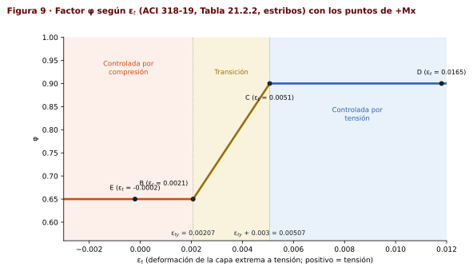

**Por qué cambia $\phi$:** una sección controlada por tensión avisa antes de fallar (el acero fluye y la columna se deforma), mientras que una controlada por compresión falla de forma frágil (el concreto se aplasta). El código premia la ductilidad con un $\phi$ mayor.

La curva de diseño se obtiene punto por punto:

$$\phi P_n = \min(\phi\,P_n,\ \phi P_{n,máx}) \qquad \phi M_n = \phi\,M_n$$

---

## 9. Paso 7 · Inciso 3 · revisión de las combinaciones

**Hoja: sección 7.** Se ingresan los 6 casos con $P_u$, $M_x$, $M_y$, $V_x$, $V_y$.

### 9.1 Reglas de la revisión

1. **Momentos no simultáneos:** $(P_u, M_x)$ se revisa en el diagrama X y $(P_u, M_y)$ en el diagrama Y, por separado.
2. **El signo elige la rama:** $M_x > 0$ usa $+M_x$; $M_x \lt  0$ usa $-M_x$; igual para $M_y$.
3. **Relación demanda/capacidad (método radial):** se traza la recta desde el origen O hasta la carga U = $(M_u, P_u)$ y se busca dónde corta la curva de diseño (punto C). Como la carga y la capacidad tienen la misma excentricidad $e = M/P$:
$$\frac{D}{C} = \frac{|OU|}{|OC|} \qquad \text{cumple si } D/C \le 1$$

> [!NOTE]
> **Por qué radial**
>
> El rayo mantiene constante la excentricidad $e = M_u/P_u$. Si las cargas crecieran en proporción, la columna fallaría en C. D/C dice qué fracción de esa capacidad se está usando.

### 9.2 Resultados

| Caso | $P_u$ | $M_x$ | Rama | $\phi P_n$ | $\phi M_n$ | D/C X | $M_y$ | Rama | $\phi P_n$ | $\phi M_n$ | D/C Y | Resultado |
|:-:|--:|--:|:-:|--:|--:|--:|--:|:-:|--:|--:|--:|---|
| 1 | 1,200 | 8,800 | +Mx | 2,188.6 | 16,049.8 | **54.8 %** | 14,200 | +My | 1,420.8 | 16,812.5 | **84.5 %** | ✅ Cumple |
| 2 | 1,600 | −5,075 | −Mx | 2,651.9 | −8,411.4 | **60.3 %** | −8,600 | −My | 2,020.6 | −10,861.0 | **79.2 %** | ✅ Cumple |
| 3 | −670 | 2,400 | +Mx | −882.9 | 3,162.8 | **75.9 %** | 2,000 | +My | −905.2 | 2,702.2 | **74.0 %** | ✅ Cumple |
| 4 | −880 | 1,000 | +Mx | −1,014.2 | 1,152.5 | **86.8 %** | 1,050 | +My | −1,027.0 | 1,225.3 | **85.7 %** | ✅ Cumple |
| 5 | −630 | −1,125 | −Mx | −1,010.0 | −1,803.6 | **62.4 %** | −4,000 | −My | −767.9 | −4,875.8 | **82.0 %** | ✅ Cumple |
| 6 | 1,800 | 3,300 | +Mx | 2,665.4 | 4,886.6 | **67.5 %** | 11,400 | +My | 2,009.0 | 12,723.4 | **89.6 %** | ✅ Cumple |

$P_u$ en kip; momentos en kip·in; $\phi P_n$ y $\phi M_n$ son las coordenadas del punto de capacidad C sobre el rayo.

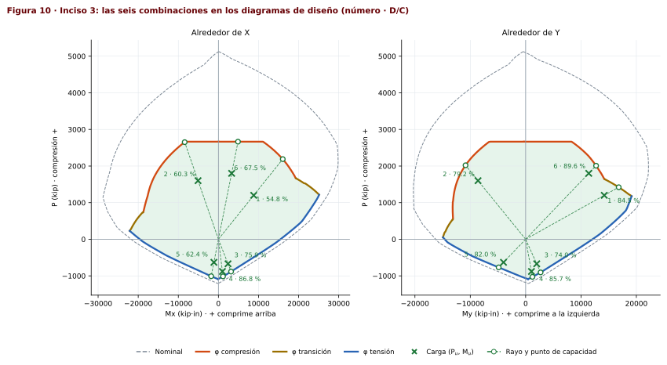

### 9.3 Ejemplo: D/C del caso 6 en Y

Carga $U = (M_y, P_u) = (11{,}400 ;\ 1{,}800)$. El rayo corta la curva $+M_y$ en el tramo entre dos puntos calculados:

$$p_1 = (12{,}692.1 ;\ 2{,}015.8) \qquad p_2 = (12{,}867.5 ;\ 1{,}977.4)$$

El punto de corte cumple $t\,U = p_1 + s\,(p_2 - p_1)$. Con $\Delta x = 175.36$ y $\Delta y = -38.46$:

$$t = \frac{x_1\,\Delta y - y_1\,\Delta x}{M_u\,\Delta y - P_u\,\Delta x} = \frac{-841{,}637}{-754{,}095} = 1.1161$$

$$C = t\,U = (12{,}723.4 ;\ 2{,}009.0) \qquad \frac{D}{C} = \frac{|OU|}{|OC|} = \frac{11{,}541.2}{12{,}881.0} = \frac{1}{t} = 0.8960 = \mathbf{89.6\ \%}$$

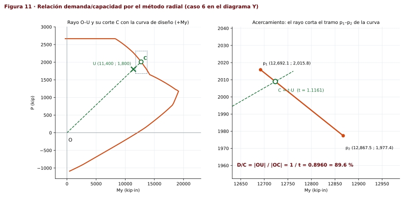

### 9.4 Revisiones axiales

$$P_{u,máx} = 1{,}800\ \text{kip} \le \phi P_{n,máx} = 2{,}665.434\ \text{kip} \quad \checkmark \qquad P_{u,mín} = -880\ \text{kip} \ge \phi P_{nt} = -1{,}088.640\ \text{kip} \quad \checkmark$$

> [!NOTE]
> **Cómo interpretar los resultados**
>
> - Los casos 1, 2 y 6 (compresión alta) caen en la parte superior; el 6 es el más exigente porque combina $P_u$ alto con el mayor $M_y$ relativo.
> - Los casos 3, 4 y 5 son de **tensión**. Ahí la capacidad depende casi solo del acero, por eso el caso 4 decidió el tamaño de las barras en el inciso 1.
> - El caso 2 tiene momentos negativos y usa las ramas $-M_x$ y $-M_y$.

> [!WARNING]
> **Lo que no revisa este método**
>
> El eje neutro paralelo ignora el $M_\perp$ inducido. Si el profesor pide flexión biaxial o el D/C queda muy cerca de 100 %, hay que revisarlo con eje neutro girado.

> [!IMPORTANT]
> **Inciso 3**
>
> Las **6 combinaciones cumplen**. D/C máximo **89.6 %** (caso 6 en Y); en X el máximo es 86.8 % (caso 4). Además $P_{u,máx} \le \phi P_{n,máx}$ y $P_{u,mín} \ge \phi P_{nt}$.

---

## 10. Paso 8 · Inciso 4 · cortante y refuerzo transversal

**Hoja: sección 8.**

### 10.1 Datos para cortante

$$\phi_v = 0.75 \quad\text{(ACI 21.2.1)} \qquad \phi_l = \#10 = 1.270\ \text{in} \qquad \phi_{l,mín} = \#9 = 1.128\ \text{in}$$

**Qué parte de la L resiste cada cortante.** Cada cortante lo resiste la pata paralela a la fuerza; la otra pata no se cuenta (igual que el ala de una viga T):

$$d_0 = rec + \phi_{es} + \frac{\phi_l}{2} = 1.575 + 0.500 + 0.635 = 2.710\ \text{in}$$

$$V_x:\ b_{w,x} = t_w = 17.717\ \text{in},\quad d_x = H - d_0 = 36.660\ \text{in}\ (93.1\ \text{cm})$$

$$V_y:\ b_{w,y} = t_f = 17.717\ \text{in},\quad d_y = B - d_0 = 28.786\ \text{in}\ (73.1\ \text{cm})$$

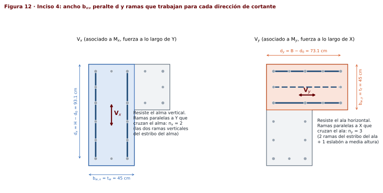

**Ramas.** $n_x$ son las ramas paralelas a Y que cruzan el alma: las 2 ramas verticales del estribo del alma ($n_x$ = 2). $n_y$ son las ramas paralelas a X que cruzan el ala: las 2 ramas horizontales del estribo del ala, más un eslabón a media altura del ala ($n_y$ = 3, ver [§10.5](#105-elección-de-la-separación)).

**¿Cortante por capacidad?**

$$\frac{l_u}{c_1} = \frac{206.69}{17.717} = 11.67 > 5$$

> [!NOTE]
> **ACI 318-19, 18.3.3**
>
> El cortante por capacidad de pórticos ordinarios se exige para columnas con $l_u \le 5c_1$. Aquí no aplica, así que $V_u$ es el que da el análisis (el del enunciado).

**Cuantía para $V_c$.** Con el criterio de la hoja de clase ($A_l\cdot$No.$\phi_l$ = 1.27·18 = 22.86 in²):

$$\rho_{w,x} = \frac{22.86}{17.717\cdot36.660} = 0.03520 \qquad \rho_{w,y} = \frac{22.86}{17.717\cdot28.786} = 0.04482$$

### 10.2 Resistencia del concreto $V_c$

> [!NOTE]
> **ACI 318-19, Tabla 22.5.5.1(b) y 22.5.5.1.1–2**
>
> $$V_c = \left[8\lambda\,\rho_w^{1/3}\sqrt{f'_c} + \frac{N_u}{6A_g}\right] b_w d, \qquad \frac{N_u}{6A_g} \le 0.05 f'_c, \qquad 0 \le V_c \le 5\lambda\sqrt{f'_c}\,b_w d$$
> $N_u$ es positivo en compresión y **negativo en tensión**.

**Qué significa:** el concreto resiste parte del cortante. La compresión lo ayuda (cierra las grietas) y la tensión lo reduce. Para el caso 1 ($N_u$ = 1,200 kip):

$$\frac{N_u}{6A_g} = \frac{1{,}200{,}000\ \text{lb}}{6\cdot941.627} = 212.40\ \text{psi} \le 0.05\cdot5000 = 250.0\ \text{psi}$$

$$V_{c,x} = \left[8\cdot1\cdot0.3277\cdot70.71 + 212.40\right]\cdot17.717\cdot36.660/1000 = 258.36\ \text{kip} > 5\sqrt{f'_c}\,b_w d = 229.63 \Rightarrow V_{c,x} = 229.63\ \text{kip}$$

$$V_{c,y} = \left[8\cdot1\cdot0.3552\cdot70.71 + 212.40\right]\cdot17.717\cdot28.786/1000 = 210.80\ \text{kip} > 180.31 \Rightarrow V_{c,y} = 180.31\ \text{kip}$$

$$\phi V_{c,x} = 0.75\cdot229.63 = 172.22\ \text{kip} \qquad \phi V_{c,y} = 0.75\cdot180.31 = 135.23\ \text{kip}$$

### 10.3 Área de refuerzo transversal

$$\frac{A_{vn}}{s} = \frac{V_u/\phi_v - V_c}{f_{yt}\,d} \qquad \frac{A_{v,mín}}{s} = \max\!\left(0.75\sqrt{f'_c}\,\frac{b_w}{f_{yt}},\ 50\,\frac{b_w}{f_{yt}}\right) \qquad \frac{A_v}{s} = \max\!\left(\frac{A_{vn}}{s},\ \frac{A_{v,mín}}{s}\right)$$

$$s_v = \frac{n\,A_{es}}{A_v/s}$$

**Qué significa:** $A_v/s$ es cuánta área de estribo se necesita por cada pulgada de altura de columna. Dividiendo el área de las ramas que trabajan ($n\,A_{es}$) entre ese valor se obtiene la separación.

Caso 1, dirección Y ($V_u$ = 345 kip):

$$\frac{A_{vn}}{s} = \frac{345/0.75 - 180.31}{60\cdot28.786} = 0.16194\ \frac{\text{in}^2}{\text{in}} \qquad \frac{A_{v,mín}}{s} = 0.01566\ \frac{\text{in}^2}{\text{in}} \;\Rightarrow\; \frac{A_v}{s} = 0.16194$$

$$s_{v,y} = \frac{2\cdot0.20}{0.16194} = 2.470\ \text{in} = 6.27\ \text{cm} \quad (n_y = 2) \qquad s_{v,y} = \frac{3\cdot0.20}{0.16194} = 3.705\ \text{in} = 9.41\ \text{cm} \quad (n_y = 3)$$

Caso 1, dirección X ($V_u$ = 250 kip, $n_x$ = 2): $A_{vn}/s$ = 0.04715 in²/in → $s_{v,x}$ = 8.484 in = 21.55 cm.

### 10.4 Separación máxima y límite de la sección

> [!NOTE]
> **ACI 318-19, 10.7.6.5.2 y 22.5.1.2**
>
> $$V_s = \frac{A_v}{s}\,f_{yt}\,d \qquad s_{máx} = \begin{cases}\min(d/2,\ 24\ \text{in}) & V_s \le 4\sqrt{f'_c}\,b_w d \\ \min(d/4,\ 12\ \text{in}) & V_s > 4\sqrt{f'_c}\,b_w d\end{cases} \qquad V_u/\phi - V_c \le 8\sqrt{f'_c}\,b_w d$$

Caso 1 en Y: $V_s$ = 279.69 kip > $4\sqrt{f'_c}\,b_w d$ = 144.25 kip → $s_{máx}$ = $\min(d_y/4,\ 12)$ = 7.197 in = **18.28 cm**. Además $V_s$ ≤ $8\sqrt{f'_c}\,b_w d$ = 288.50 kip, así que la sección es suficiente.

Caso 1 en X: $V_s$ = 103.70 kip ≤ 183.70 kip → $s_{máx}$ = $\min(d_x/2,\ 24)$ = 18.330 in = 46.56 cm.

**Todas las combinaciones** (con $n_x$ = 2, $n_y$ = 3; fuerzas en kip):

| Caso | $P_u$ (kip) | $N_u/6A_g$ (psi) | $V_x$ | $V_{c,x}$ | $\phi V_{c,x}$ | $A_v/s$ x (in²/in) | $s_{v,x}$ (cm) | $s_{máx,x}$ (cm) | $V_y$ | $V_{c,y}$ | $\phi V_{c,y}$ | $A_v/s$ y (in²/in) | $s_{v,y}$ (cm) | $s_{máx,y}$ (cm) |
|:-:|--:|--:|--:|--:|--:|--:|--:|--:|--:|--:|--:|--:|--:|--:|
| 1 | 1,200 | 212.4 | 250 | 229.6 | 172.2 | 0.0471 | 21.6 | 46.6 | 345 | 180.3 | 135.2 | 0.1619 | 9.4 | 18.3 |
| 2 | 1,600 | 250.0 | 175 | 229.6 | 172.2 | 0.0157 | 64.9 | 46.6 | 240 | 180.3 | 135.2 | 0.0809 | 18.8 | 36.6 |
| 3 | −670 | −118.6 | 120 | 43.4 | 32.5 | 0.0530 | 19.2 | 46.6 | 115 | 42.0 | 31.5 | 0.0645 | 23.6 | 36.6 |
| 4 | −880 | −155.8 | 80 | 19.2 | 14.4 | 0.0397 | 25.6 | 46.6 | 78 | 23.0 | 17.3 | 0.0469 | 32.5 | 36.6 |
| 5 | −630 | −111.5 | 85 | 48.0 | 36.0 | 0.0297 | 34.2 | 46.6 | 160 | 45.6 | 34.2 | 0.0971 | 15.7 | 18.3 |
| 6 | 1,800 | 250.0 | 150 | 229.6 | 172.2 | 0.0157 | 64.9 | 46.6 | 325 | 180.3 | 135.2 | 0.1465 | 10.4 | 18.3 |

> [!NOTE]
> **Los casos en tensión**
>
> En los casos 3, 4 y 5 el término $N_u/6A_g$ es negativo y $V_c$ cae a 19–48 kip. Aun así no controlan porque sus cortantes son menores.

### 10.5 Elección de la separación

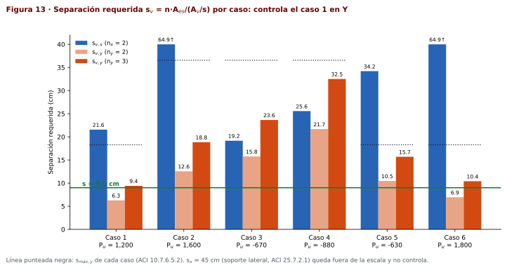

Controla el **caso 1 en Y** (el ala, con $V_y$ = 345 kip). Con solo los 2 estribos ($n_y$ = 2) la separación saldría en 6.0 cm, demasiado cerrada para colar bien. Por eso se agrega **un eslabón horizontal a media altura del ala** (entre la barra de s5 y la de s3, que están a la misma altura) y $n_y$ pasa a 3:

$$s = \text{Floor}\big(\min(s_v,\ s_{máx}),\ 0.5\ \text{cm}\big) = \text{Floor}(9.41\ \text{cm},\ 0.5) = \mathbf{9.0\ cm}$$

Otras opciones válidas: 4 ramas en el ala → 12.5 cm; estribo #5 con 2 ramas → 9.5 cm.

> [!TIP]
> **En la hoja**
>
> Cambia $n_y$ de 2 a 3 en la sección 8. La tabla por combinación se recalcula y la separación de diseño pasa a 9.0 cm.

### 10.6 Soporte lateral de las barras y separación por pandeo

**Separación máxima de estribos** (evita que las barras longitudinales se pandeen):

$$s_x = \text{Floor}\big(\min(16\,\phi_{l,mín},\ 48\,\phi_{es},\ \text{menor dimensión}),\ 0.5\ \text{cm}\big) = \text{Floor}(\min(45.84,\ 60.96,\ 45.00)\ \text{cm}) = 45.0\ \text{cm}$$

No controla (9 cm < 45.0 cm).

> [!NOTE]
> **ACI 318-19, 25.7.2.3**
>
> Toda barra de esquina y barras alternas deben tener soporte lateral (esquina de estribo o eslabón), y ninguna barra sin soporte puede quedar a más de **6 in libres** (15.24 cm) de una barra soportada.

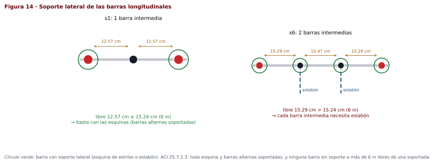

- En s1–s5 y s8 hay 1 barra intermedia con separación libre de 12.57 o 14.46 cm ≤ 15.24 cm: basta con las esquinas.
- En s6 y s7 hay 2 barras con separación libre de 15.29 cm > 15.24 cm: **cada barra intermedia necesita soporte**. Como las barras de s6 y s7 están a la misma altura, **2 eslabones horizontales** (uno por nivel) soportan las 4 barras.

### 10.7 Esquema final de la sección

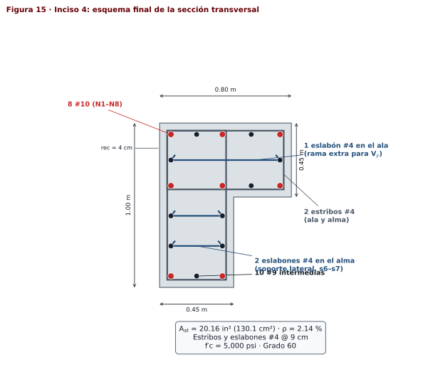

> [!IMPORTANT]
> **Inciso 4**
>
> - Concreto: $\phi V_{c,x}$ = 172.22 kip y $\phi V_{c,y}$ = 135.23 kip en el caso 1; en los casos en tensión baja a 14–36 kip.
> - Refuerzo transversal **#4 @ 9.0 cm** en toda la altura: 2 estribos rectangulares (ala y alma), 1 eslabón horizontal en el ala (rama extra para $V_y$) y 2 eslabones horizontales en el alma (soporte lateral de s6–s7).
> - $s$ = 9.0 cm ≤ $s_{máx}$ = 18.28 cm y ≤ $s_x$ = 45.0 cm.

---

## 11. Resumen de resultados

| Inciso | Qué se pidió | Resultado |
|---|---|---|
| 1 | Armado entre 1 % y 4 % | 8 #10 + 10 #9 · $A_{st}$ = 20.16 in² · $\rho$ = 2.14 % |
| 2 | Diagramas ±X y ±Y | 4 ramas; $P_o = 5{,}125.834$ kip, $\phi P_{n,máx} = 2{,}665.434$ kip, $P_{nt} = -1{,}209.600$ kip; tablas §7 y Figura 10 |
| 3 | Revisión de 6 combinaciones | Todas cumplen; D/C máx. 89.6 % (caso 6, Y) |
| 4 | Cortante y estribos | #4 @ 9.0 cm: 2 estribos + 3 eslabones; $s_x$ = 45.0 cm no controla |

---

## 12. Glosario de símbolos

| Símbolo | Significado | P3 |
|---|---|---|
| $f'_c$ | Resistencia especificada a compresión del concreto | 5 ksi |
| $f_y$, $f_{yt}$ | Fluencia del acero longitudinal y transversal | 60 ksi |
| $E_s$ | Módulo de elasticidad del acero | 29,000 ksi |
| $\varepsilon_{cu}$ | Deformación máxima del concreto en la fibra extrema comprimida | 0.003 |
| $\beta_1$ | Relación entre la profundidad del bloque $a$ y el eje neutro $c$ | 0.80 |
| $\varepsilon_{ty}$ | Deformación de fluencia del acero | 0.00207 |
| $A_g$ | Área bruta de la sección | 941.627 in² |
| $G$, $\bar x$, $\bar y$ | Centroide geométrico y sus coordenadas | (12.941 ; 22.492) in |
| $A_{st}$, $\rho$ | Área total de acero longitudinal y cuantía | 20.16 in² · 2.14 % |
| $REC$ | Del borde al centro de una barra principal | 2.710 in |
| $D$ | Peralte total en la dirección de análisis | H o B |
| $d_i$ | Profundidad de la capa $i$ desde la fibra comprimida | tablas §6 |
| $d_t$ | Profundidad de la capa extrema a tensión | tablas §6 |
| $\bar v$ | Profundidad del punto de referencia (G); en la rectangular es $h/2$ | tablas §6 |
| $c$ | Profundidad del eje neutro | variable |
| $a$ | Profundidad del bloque equivalente de Whitney, $a = \beta_1 c$ | variable |
| $A_c$, $v_c$ | Área comprimida de concreto y profundidad de su centroide | variable |
| $P_c$ | Fuerza del concreto, $0.85 f'_c A_c$ | variable |
| $\varepsilon_{si}$, $f_{si}$, $C_{si}$ | Deformación, esfuerzo y fuerza de la capa $i$ (compresión positiva en $f$ y $C$) | variable |
| $P_n$, $M_n$ | Resistencias nominales (sin φ) | variable |
| $M_\perp$ | Momento que se induce en la otra dirección por la asimetría de la L | variable |
| $\varepsilon_t$, $\phi$ | Deformación de la capa extrema a tensión y factor de reducción | variable |
| $P_o$ | Compresión pura nominal | 5,125.834 kip |
| $\phi P_{n,máx}$ | Tope de la curva de diseño, $0.65\cdot0.80\,P_o$ | 2,665.434 kip |
| D/C | Demanda / capacidad medida sobre el rayo desde el origen | ≤ 1 cumple |
| $b_w$, $d$ | Ancho y peralte que resisten el cortante en cada dirección | tablas §10 |
| $\rho_w$ | Cuantía longitudinal usada en $V_c$ | tablas §10 |
| $N_u$ | Carga axial de la combinación (+ compresión, − tensión) | $P_u$ |
| $V_c$, $V_s$ | Cortante resistido por el concreto y por el acero transversal | variable |
| $A_v/s$ | Área de refuerzo transversal por unidad de longitud | variable |
| $n$, $A_{es}$ | Ramas que cruzan el plano de falla y área de una rama #4 | 0.20 in² |
| $s$, $s_x$ | Separación del refuerzo transversal y límite por soporte lateral | 9.0 cm |

---

## 13. Secciones de ACI 318-19 utilizadas

| Sección | Para qué se usa |
|---|---|
| 10.6.1.1 | Cuantía longitudinal 1 %–8 % |
| 10.6.2.2 | Área mínima de refuerzo a cortante |
| 10.7.3.1 | Mínimo 4 barras con estribos |
| 10.7.6.5.2 | Separación máxima por cortante |
| 18.3.3 | Cortante por capacidad (no aplica, $l_u/c_1$ > 5) |
| 20.2.2.1–2 | Ley esfuerzo-deformación y $E_s$ del acero |
| 21.2.1, Tabla 21.2.2 | $\phi_v$ = 0.75; $\phi$ de 0.65 a 0.90 según $\varepsilon_t$ |
| 22.2.1.2, 22.2.2.1, 22.2.2.2 | Compatibilidad, $\varepsilon_{cu}$ = 0.003, sin tensión en el concreto |
| 22.2.2.4.1, Tabla 22.2.2.4.3 | Bloque $0.85f'_c$ y $\beta_1$ |
| 22.4.2.1–2 | $P_o$ y $P_{n,máx}$ = 0.80 $P_o$ |
| 22.4.3.1 | Tensión pura |
| 22.5.1.2 | Límite de la sección por cortante |
| Tabla 22.5.5.1 | $V_c$ con carga axial |
| 25.2.3 | Separación libre mínima entre barras |
| 25.7.2.1 | Separación de estribos ($16d_b$, $48d_{es}$, menor dimensión) |
| 25.7.2.3 | Soporte lateral de barras |

---

## 14. Verificación y limitaciones

- **Verificación del motor de la hoja:** el cálculo exacto por rectángulos coincide con un modelo de fibras de 0.02 in en menos de 0.1 %, y con la sección rectangular 80×80 de clase reproduce los mismos resultados que la hoja v4.
- **Momento perpendicular:** la revisión ignora $M_\perp$ (27 %–56 % de $M$ en el punto B). Es la simplificación de clase; una revisión más rigurosa giraría el eje neutro hasta anular $M_\perp$ o usaría la superficie de interacción biaxial.
- **Columna corta:** no se revisó esbeltez.
- **$\rho_w$ en $V_c$:** se usó el criterio de la hoja de clase ($A_l\cdot$No.$\phi_l$ con la barra mayor). La hoja permite cambiarlo a $A_{st}$ real o a las barras a más de $2D/3$ (comentario R22.5.5.1); el resultado de este examen no cambia.

> [!TIP]
> **Para estudiar con la hoja**
>
> Abre la hoja con el botón *Ejemplo P3 · columna L*, cambia $n_y$ a 3 y recorre las secciones en el orden de este manual. En la vista *Perfil de cálculo* puedes elegir cualquier punto (A–F o *c libre*) y ver deformaciones, esfuerzos y fuerzas como en la Figura 7.
