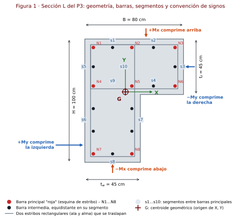
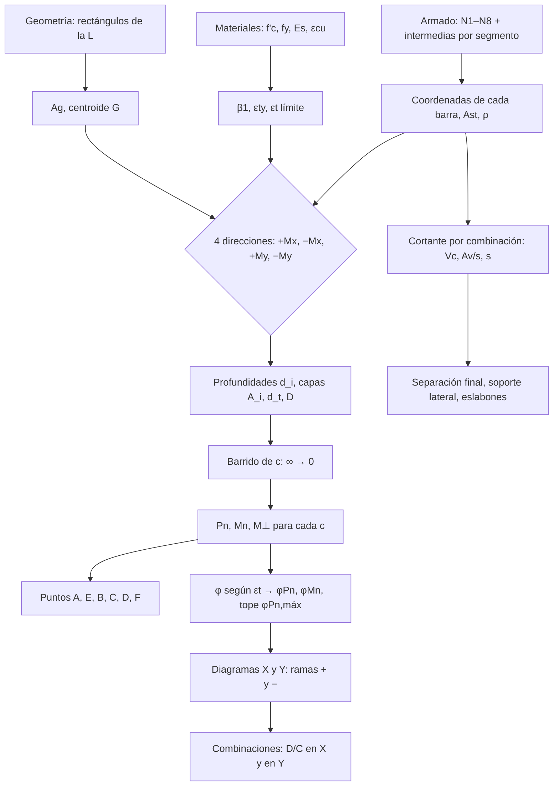
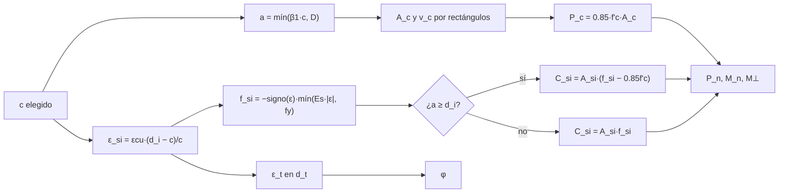
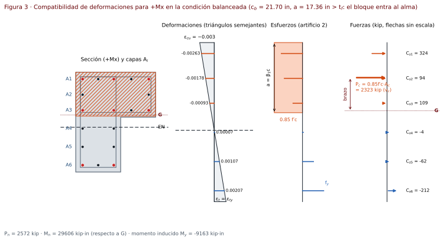
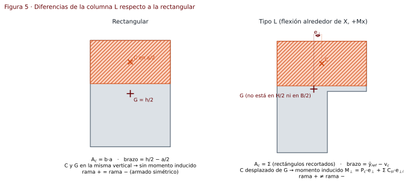
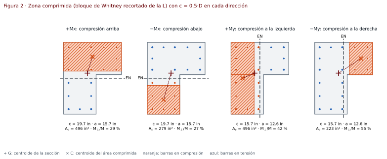
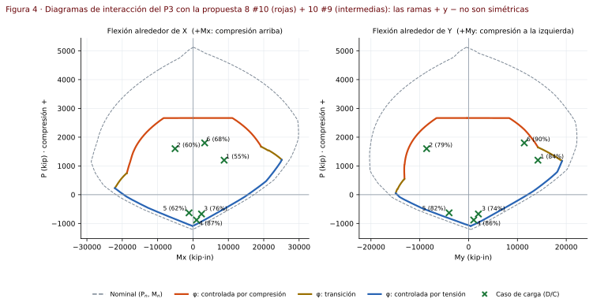

# Procedimiento · Diagrama de interacción para columnas tipo L

Hoja de cálculo interactiva (un solo archivo HTML) para construir el diagrama de interacción **P–M** de columnas de concreto reforzado con sección en **L**, revisar combinaciones de carga y diseñar el refuerzo transversal por cortante, según **ACI 318-19**.

Es la **versión 5** de la hoja de columnas del curso. La versión 4 solo resolvía secciones rectangulares; esta generaliza el mismo procedimiento de clase (compatibilidad de deformaciones, artificios 1 y 2, puntos A–F) a secciones formadas por rectángulos, empezando por la L.

`ACI 318-19` · `kip · in · ksi` · `compatibilidad de deformaciones` · `flexión uniaxial ±X, ±Y` · `caso de prueba: P3-ECR`

**Hoja en línea:** [abrir en GitHub Pages](https://a-terron.github.io/Diagrama-de-Interacci-n---Columnas/) · archivo [`index.html`](../index.html) en la raíz del repositorio. Abre con el ejemplo del P3 cargado; los botones de la barra superior cargan el P3 o el ejemplo de clase 80×80. La solución completa del P3 paso a paso está en el [manual](manual-P3-ECR-columna-L.md). Versión web en español: [procedimiento-columna-L.html](https://a-terron.github.io/Diagrama-de-Interacci-n---Columnas/docs/procedimiento-columna-L.html).

---

## Contenido

1. [Qué hace la hoja](#1-qué-hace-la-hoja)
2. [Estructura del repositorio](#2-estructura-del-repositorio)
3. [Datos de entrada](#3-datos-de-entrada)
4. [Supuestos](#4-supuestos)
5. [Tipo de análisis](#5-tipo-de-análisis)
6. [Procedimiento paso a paso](#6-procedimiento-paso-a-paso)
7. [Secciones de ACI 318-19 utilizadas](#7-secciones-de-aci-318-19-utilizadas)
8. [Diferencias con la columna rectangular](#8-diferencias-con-la-columna-rectangular)
9. [Caso de prueba: P3-ECR](#9-caso-de-prueba-p3-ecr)
10. [Validación](#10-validación)
11. [Limitaciones y trabajo futuro](#11-limitaciones-y-trabajo-futuro)
12. [Referencias](#12-referencias)

---

## 1. Qué hace la hoja

- Define la sección como **unión de rectángulos** (la L son dos: ala y alma) y calcula $`A_g`$ y el centroide.
- Coloca las barras con un **generador tipo P3**: 8 barras principales en las esquinas de los estribos y barras intermedias **equidistantes** en cada segmento entre ellas. Opcionalmente, las barras se editan como tabla de coordenadas.
- Calcula el diagrama **nominal** $`(P_n, M_n)`$ y de **diseño** $`(\phi P_n, \phi M_n)`$ en las **cuatro direcciones**: $`+M_x`$, $`-M_x`$, $`+M_y`$, $`-M_y`$.
- Desarrolla los puntos notables **A–F** con todas las sustituciones (tablas por capa, como en la hoja de clase).
- Revisa cada combinación $`(P_u, M_x, M_y, V_x, V_y)`$: relación demanda/capacidad en el diagrama X y en el Y por separado, y cortante.
- Diseña el refuerzo transversal: $`V_c`$, $`A_v/s`$, separación, separación máxima, soporte lateral y **eslabones** requeridos por segmento.
- Muestra el **momento perpendicular inducido** $`M_\perp`$ que aparece por la asimetría de la L.

### Vistas de la hoja

| Vista | Qué muestra |
|---|---|
| **Perfil de cálculo** | La sección girada con la fibra comprimida arriba (en cualquiera de las 4 direcciones) y, alineados con ella, los diagramas de deformaciones, esfuerzos (bloque de $`0.85f'_c`$ y $`f_{si}`$) y fuerzas ($`P_c`$ en $`v_c`$ y cada $`C_{si}`$). El eje de la izquierda tiene las cotas $`d_i`$, $`\bar v`$, $`c`$ y $`a`$. |
| **Planta** | La sección en su orientación real con cotas $`B`$, $`H`$, $`t_f`$, $`t_w`$, $`\bar x`$ y $`\bar y`$, capas $`A_i`$, eje neutro y bloque con su valor, estribos y eslabones. |
| **Diagramas X y Y** | Curvas nominal y de diseño por zona, región segura sombreada, puntos A–F (′ = rama negativa) y cada combinación con su **rayo D/C** hasta el punto de capacidad. |

Las unidades de cotas, esfuerzos, fuerzas y momentos se eligen dentro de cada vista. En los diagramas:

- **Cursor de lectura:** al pasar el cursor, la hoja lee $`\phi M_n`$ en las ramas + y − para la $`P`$ del cursor.
- **Zoom:** botones *Todo*, *Combinaciones* y *Zona de tensión*; con el mouse, arrastrar sobre la gráfica acerca ese rectángulo y el doble clic vuelve a *Todo*.
- **Resaltado:** tocar una combinación en la gráfica o en cualquier tabla la resalta en ambos diagramas y muestra $`\phi P_n`$, $`\phi M_n`$ en el rayo y su D/C.

La hoja ya no lleva párrafos de instrucciones: todo lo que explica el procedimiento está en este archivo.

## 2. Estructura del repositorio

```text
├── index.html                       Hoja interactiva (HTML + CSS + JS en un solo archivo, sin dependencias)
├── README.md                        Portada del repositorio
├── docs/
│   ├── procedimiento-columna-L.md   Este documento
│   ├── manual-P3-ECR-columna-L.md   Solución del P3-ECR paso a paso
│   ├── *.html                       Versiones web en español de estos dos documentos (GitHub Pages)
│   └── img/
│       ├── fig1-seccion-L.svg            Geometría, barras, segmentos y signos
│       ├── fig2-bloque-compresion.svg    Zona comprimida en las 4 direcciones
│       ├── fig3-deformaciones.svg        Compatibilidad de deformaciones (+Mx, punto B)
│       ├── fig4-diagramas-P3.svg         Diagramas X y Y del caso de prueba
│       ├── fig5-rectangular-vs-L.svg     Diferencias con la sección rectangular
│       └── P3-01 … P3-15                 Figuras del manual (P3-08-1 … P3-08-7: área comprimida)
└── obsidian/
    └── Manual P3-ECR - Columna L.md      Manual en formato Obsidian
```

## 3. Datos de entrada

| Grupo | Dato | Símbolo | P3-ECR |
|---|---|---|---|
| Materiales | Resistencia del concreto | $`f'_c`$ | 5,000 psi |
| | Fluencia del acero (longitudinal y transversal) | $`f_y`$, $`f_{yt}`$ | 60 ksi (Grado 60) |
| | Módulo del acero | $`E_s`$ | 29,000 ksi |
| | Deformación última del concreto | $`\varepsilon_{cu}`$ | 0.003 |
| Geometría L | Ancho total (dirección X) | $`B`$ | 0.80 m |
| | Alto total (dirección Y) | $`H`$ | 1.00 m |
| | Espesor del ala (horizontal) | $`t_f`$ | 0.45 m |
| | Espesor del alma (vertical) | $`t_w`$ | 0.45 m |
| | Esquina exterior | — | superior izquierda |
| | Recubrimiento libre al estribo | $`rec`$ | 0.04 m |
| Refuerzo | Estribo | $`\phi_{es}`$ | #4 (propuesto) |
| | Barras principales ("rojas") | $`N_1 \dots N_8`$ | #10 (propuesto) |
| | Barras intermedias por segmento | $`n_{s1} \dots n_{s10}`$ | 1,1,1,1,1,2,2,1,0,0 |
| | Varilla de las intermedias | — | #9 (propuesto) |
| Columna | Altura total / altura libre | $`H_c`$, $`l_u`$ | 6.00 m / 5.25 m |
| Cargas | Combinaciones | $`P_u, M_x, M_y, V_x, V_y`$ | 6 casos |

Las unidades de cada dato se eligen junto a la celda; internamente todo se calcula en **kip, in y ksi**.

## 4. Supuestos

1. **Secciones planas permanecen planas**: la deformación varía linealmente con la distancia al eje neutro (ACI 22.2.1.2).
2. **Concreto**: deformación máxima $`\varepsilon_{cu} = 0.003`$ en la fibra extrema comprimida (ACI 22.2.2.1); resistencia a tensión despreciada (ACI 22.2.2.2); bloque rectangular equivalente de $`0.85f'_c`$ con profundidad $`a = \beta_1 c`$ (ACI 22.2.2.4.1).
3. **Acero**: elastoplástico perfecto, $`f_s = E_s\,\varepsilon_s \le f_y`$ en tensión y compresión (ACI 20.2.2.1). Cada barra concentra su área en su centro.
4. **Adherencia perfecta**: la barra tiene la misma deformación que el concreto que la rodea.
5. **Concreto desplazado**: si una barra queda dentro del bloque ($`a \ge d_i`$) se resta $`0.85f'_c`$ de su esfuerzo, como en la hoja de clase.
6. **Flexión uniaxial**: $`M_x`$ y $`M_y`$ no actúan simultáneamente (lo pide el P3). Cada diagrama se construye con el **eje neutro paralelo** al eje de flexión.
7. **Momento perpendicular inducido**: como la L no es simétrica, ese eje neutro paralelo genera un momento en la otra dirección ($`M_\perp`$). La hoja lo calcula y lo reporta, pero **no** lo incluye en la revisión (método de clase).
8. **Referencia de momentos**: centroide geométrico $`G`$ de la sección (generaliza el $`h/2`$ de la columna rectangular y coincide con los ejes del modelo de análisis). Opción: centroide plástico.
9. **Columna corta**: sin efectos de esbeltez ni momentos de segundo orden.
10. **Refuerzo transversal de estribos** (no zuncho): $`\phi = 0.65`$ en compresión y $`P_{n,máx} = 0.80P_o`$.
11. **Cortante**: detalle ordinario. Cada dirección de cortante la resiste la pata de la L paralela a la fuerza ($`b_w`$ = espesor de esa pata); no se suma el aporte de la otra pata.

### Convención de signos

| Magnitud | Positivo | Negativo |
|---|---|---|
| Carga axial $`P`$ | compresión | tensión |
| Deformación $`\varepsilon_s`$ | tensión | compresión |
| Esfuerzo y fuerza $`f_s`$, $`C_s`$ | compresión | tensión |
| $`M_x`$ | comprime la fibra **superior** (ala de 0.80 m) | comprime la fibra inferior (pie del alma) |
| $`M_y`$ | comprime la fibra **izquierda** (alma de 1.00 m) | comprime la fibra derecha (punta del ala) |
| $`V_x`$ | cortante asociado a $`M_x`$ (fuerza a lo largo de Y), lo resiste el alma | |
| $`V_y`$ | cortante asociado a $`M_y`$ (fuerza a lo largo de X), lo resiste el ala | |



## 5. Tipo de análisis

**Análisis seccional de resistencia última por compatibilidad de deformaciones** (ACI 22.2), con barrido del eje neutro. No es un análisis elástico ni por fibras: el bloque de Whitney se aplica de forma **exacta** sobre la forma real de la sección.

- **Concreto**: la zona comprimida es el pedazo de la sección que queda a menos de $`a`$ de la fibra extrema. Como la sección es una unión de rectángulos y el eje neutro es paralelo a un eje, ese pedazo también es una unión de rectángulos; su área y su centroide se calculan en forma cerrada (sin discretizar).
- **Acero**: se evalúa barra por barra. Las barras con la misma profundidad $`d_i`$ se agrupan en una **capa** $`A_i`$ solo para presentar las tablas, igual que en clase.
- **Curva**: se recorre $`c`$ desde $`\infty`$ (compresión pura) hasta $`0`$ (tensión pura), con más densidad entre $`0.01D`$ y $`1.6D`$, y se agregan exactamente los puntos B, C, D y E.
- **Revisión de cargas**: método radial. Cada combinación se une con el origen y se busca dónde esa recta corta la curva de diseño.



## 6. Procedimiento paso a paso

### 6.1 Materiales

```math
\beta_1 =
\begin{cases}
0.85 & f'_c \le 4000\ \text{psi}\\
0.85 - 0.05\,\dfrac{f'_c - 4000}{1000} & 4000 < f'_c < 8000\ \text{psi}\\
0.65 & f'_c \ge 8000\ \text{psi}
\end{cases}
\qquad
\varepsilon_{ty} = \frac{f_y}{E_s}
\qquad
\varepsilon_{t,\text{tens}} = \varepsilon_{ty} + 0.003
```

Para el P3: $`\beta_1 = 0.80`$, $`\varepsilon_{ty} = 0.002069`$ y $`\varepsilon_{t,\text{tens}} = 0.005069`$.

### 6.2 Geometría

La L se descompone en dos rectángulos que no se traslapan (esquina exterior arriba a la izquierda, origen en la esquina inferior izquierda):

| Rectángulo | $`x_0`$ | $`y_0`$ | ancho | alto |
|---|---|---|---|---|
| R1 · ala | 0 | $`H - t_f`$ | $`B`$ | $`t_f`$ |
| R2 · alma bajo el ala | 0 | 0 | $`t_w`$ | $`H - t_f`$ |

```math
A_g = \sum A_j \qquad \bar x = \frac{\sum A_j\,x_j}{A_g} \qquad \bar y = \frac{\sum A_j\,y_j}{A_g}
```

P3: $`A_g = 0.6075\ \text{m}^2 = 941.63\ \text{in}^2`$; $`G = (32.87,\ 57.13)`$ cm desde la esquina inferior izquierda. Las otras tres orientaciones de la L se obtienen reflejando en X o en Y.

El centroide plástico (opcional) es el punto donde actúa $`P_o`$:

```math
x_{pc} = \frac{0.85f'_c\left(A_g\bar x - \sum A_{si}x_i\right) + f_y\sum A_{si}x_i}{P_o}
```

En el P3 queda a 0.09 in del centroide geométrico, así que la elección no cambia los resultados.

### 6.3 Armado longitudinal

Con $`REC = rec + \phi_{es} + \phi_p/2`$ (centro de la barra principal), las barras principales están en la intersección de tres líneas verticales y tres horizontales:

```math
x_a = REC,\quad x_b = t_w - REC,\quad x_c = B - REC \qquad
y_a = REC,\quad y_b = H - t_f + REC,\quad y_c = H - REC
```

| Nodo | Coordenada | Ubicación |
|---|---|---|
| N1, N2, N3 | $`(x_a, y_c)`$, $`(x_b, y_c)`$, $`(x_c, y_c)`$ | cara superior |
| N4, N5, N6 | $`(x_a, y_b)`$, $`(x_b, y_b)`$, $`(x_c, y_b)`$ | nivel inferior del ala (N5 = esquina entrante) |
| N7, N8 | $`(x_a, y_a)`$, $`(x_b, y_a)`$ | pie del alma |

Cada segmento entre dos nodos recibe $`n`$ barras intermedias a separación uniforme (requisito del P3):

```math
\mathbf{p}_k = \mathbf{N}_i + \frac{k}{n+1}\left(\mathbf{N}_j - \mathbf{N}_i\right), \qquad k = 1 \dots n
```

| Segmento | Entre | Cara | P3 |
|---|---|---|---|
| s1 | N1–N2 | superior, sobre el alma | 1 |
| s2 | N2–N3 | superior, sobre el ala | 1 |
| s3 | N3–N6 | punta del ala | 1 |
| s4 | N5–N6 | cara inferior del ala | 1 |
| s5 | N1–N4 | izquierda, a la altura del ala | 1 |
| s6 | N4–N7 | izquierda, alma | 2 |
| s7 | N5–N8 | derecha del alma | 2 |
| s8 | N7–N8 | pie del alma | 1 |
| s9, s10 | N4–N5, N2–N5 | líneas interiores (traslape de estribos) | 0 |

Revisiones del armado:

- Cuantía: $`\rho = A_{st}/A_g`$, entre 1 % y 8 % (ACI 10.6.1.1); el P3 pide además 1 %–4 %.
- Número mínimo de barras: 4 (ACI 10.7.3.1).
- Separación libre en cada segmento: $`s_{libre} \ge \max(1.5\ \text{in},\ 1.5d_b)`$ (ACI 25.2.3).

### 6.4 Direcciones de análisis

Cada dirección se define por la fibra extrema comprimida. La profundidad de un punto se mide desde esa fibra.

| Dirección | Fibra comprimida | Profundidad de la barra $`d_i`$ | Peralte total $`D`$ | Referencia $`\bar v`$ |
|---|---|---|---|---|
| $`+M_x`$ | superior, $`y = H`$ | $`H - y_i`$ | $`H`$ | $`H - \bar y`$ |
| $`-M_x`$ | inferior, $`y = 0`$ | $`y_i`$ | $`H`$ | $`\bar y`$ |
| $`+M_y`$ | izquierda, $`x = 0`$ | $`x_i`$ | $`B`$ | $`\bar x`$ |
| $`-M_y`$ | derecha, $`x = B`$ | $`B - x_i`$ | $`B`$ | $`B - \bar x`$ |

$`d_t = \max(d_i)`$ es la profundidad de la barra extrema en tensión, que controla $`\phi`$.

### 6.5 Estado de la sección para un eje neutro $`c`$

**Artificio 1** (triángulos semejantes) y **artificio 2** (esfuerzo con signo de clase):

```math
\varepsilon_{si} = \varepsilon_{cu}\,\frac{d_i - c}{c}
\qquad
f_{si} = -\mathrm{signo}(\varepsilon_{si})\cdot\min\!\left(E_s\,|\varepsilon_{si}|,\ f_y\right)
```

**Bloque de compresión**: $`a = \min(\beta_1 c,\ D)`$. Cada rectángulo $`j`$ con profundidades $`[v_{0j}, v_{1j}]`$ aporta la parte que queda dentro de $`[0, a]`$:

```math
h_j(a) = \max\!\big(0,\ \min(v_{1j}, a) - v_{0j}\big)
\qquad
A_c = \sum_j b_j\,h_j(a)
\qquad
v_c = \frac{\sum_j b_j\,h_j(a)\,\big(v_{0j} + h_j/2\big)}{A_c}
```

Para la L en $`+M_x`$ esto se reduce a dos casos (la figura 3 muestra el segundo):

```math
a \le t_f:\quad A_c = B\,a,\quad v_c = \frac{a}{2}
\qquad\qquad
a > t_f:\quad A_c = B\,t_f + t_w\,(a - t_f),\quad v_c = \frac{B\,t_f^2/2 + t_w\,(a - t_f)\,(a + t_f)/2}{A_c}
```

En $`-M_x`$ el bloque empieza en el pie del alma: $`A_c = t_w\,a`$ mientras $`a \le H - t_f`$, y luego se suma el ala. En $`\pm M_y`$ ocurre lo mismo con los papeles de $`B`$, $`H`$, $`t_f`$ y $`t_w`$ intercambiados.

**Fuerzas y resultantes** (compresión positiva):

```math
P_c = 0.85\,f'_c\,A_c
\qquad
C_{si} =
\begin{cases}
A_{si}\,f_{si} & a < d_i\\
A_{si}\,(f_{si} - 0.85f'_c) & a \ge d_i
\end{cases}
```

```math
P_n = P_c + \sum C_{si}
\qquad
M_n = P_c\,(\bar v - v_c) + \sum C_{si}\,(\bar v - d_i)
```

En la rectangular $`\bar v = h/2`$ y $`v_c = a/2`$, que es exactamente la fórmula de clase. **Momento perpendicular inducido** (con $`u`$ = coordenada a lo largo del eje neutro y $`\bar u`$ la de $`G`$):

```math
M_\perp = P_c\,(u_c - \bar u) + \sum C_{si}\,(u_i - \bar u)
```





### 6.6 Puntos notables

| Punto | Condición | Eje neutro |
|---|---|---|
| **A** · compresión pura | todo comprimido, $`f_s = f_y`$ | $`c \to \infty`$: $`P_o = 0.85f'_c(A_g - A_{st}) + f_yA_{st}`$ |
| **E** · eje neutro igual al peralte | sección completa comprimida | $`c = D`$ |
| **B** · balanceada | el concreto llega a $`\varepsilon_{cu}`$ y la barra extrema fluye | $`c_b = \dfrac{\varepsilon_{cu}\,d_t}{\varepsilon_{cu} + \varepsilon_{ty}}`$ |
| **C** · inicio de control por tensión | $`\varepsilon_t = \varepsilon_{ty} + 0.003`$ | $`c = \dfrac{\varepsilon_{cu}\,d_t}{\varepsilon_{cu} + \varepsilon_{ty} + 0.003}`$ |
| **D** · flexión pura | $`P_n = 0`$ | raíz de $`P_n(c) = 0`$ por bisección |
| **F** · tensión pura | todo el acero fluye a tensión | $`c \le 0`$: $`P_{nt} = -f_yA_{st}`$ |

En la L, $`M_A`$ y $`M_F`$ no son exactamente cero si el acero no es simétrico respecto a $`G`$.

### 6.7 Factor φ y curva de diseño

| Zona | Condición | $`\phi`$ (estribos) |
|---|---|---|
| Controlada por compresión | $`\varepsilon_t \le \varepsilon_{ty}`$ | 0.65 |
| Transición | $`\varepsilon_{ty} < \varepsilon_t < \varepsilon_{ty} + 0.003`$ | $`0.65 + 0.25\,\dfrac{\varepsilon_t - \varepsilon_{ty}}{0.003}`$ |
| Controlada por tensión | $`\varepsilon_t \ge \varepsilon_{ty} + 0.003`$ | 0.90 |

```math
\phi P_{n,máx} = 0.65 \cdot 0.80\,P_o
\qquad
\phi P_n = \min(\phi P_n,\ \phi P_{n,máx})
\qquad
\phi M_n = \phi\,M_n
```

### 6.8 Revisión de combinaciones

Para cada combinación se revisan dos puntos independientes: $`(P_u, M_x)`$ en el diagrama X y $`(P_u, M_y)`$ en el diagrama Y. El signo del momento decide qué rama se usa. La relación demanda/capacidad es

```math
D/C = \frac{\sqrt{P_u^2 + M_u^2}}{\sqrt{(\phi P_n)^2 + (\phi M_n)^2}}
```

medida sobre la recta que pasa por el origen y por $`(M_u, P_u)`$. Cumple si $`D/C \le 1`$; en clase se recomienda trabajar entre 85 % y 95 %.

### 6.9 Cortante

Se revisa cada combinación con su propia carga axial ($`N_u = P_u`$, positiva en compresión y negativa en tensión):

| Cortante | Lo resiste | $`b_w`$ | $`d`$ |
|---|---|---|---|
| $`V_x`$ (asociado a $`M_x`$) | alma vertical | $`t_w`$ | $`d_x = H - rec - \phi_{es} - \phi_l/2`$ |
| $`V_y`$ (asociado a $`M_y`$) | ala horizontal | $`t_f`$ | $`d_y = B - rec - \phi_{es} - \phi_l/2`$ |

```math
V_c = \left[8\lambda\,\rho_w^{1/3}\sqrt{f'_c} + \min\!\left(\frac{N_u}{6A_g},\ 0.05f'_c\right)\right] b_w d \;\ge 0,
\qquad V_c \le 5\lambda\sqrt{f'_c}\,b_w d
```

```math
\frac{A_{vn}}{s} = \frac{V_u/\phi_v - V_c}{f_{yt}\,d}
\qquad
\frac{A_{v,mín}}{s} = \max\!\left(0.75\sqrt{f'_c}\,\frac{b_w}{f_{yt}},\ 50\,\frac{b_w}{f_{yt}}\right)
\qquad
s_v = \frac{n\,A_{es}}{A_v/s}
```

- $`\rho_w`$: por defecto $`A_l\cdot\text{No.}\phi_l/(b_w d)`$ como en la hoja de clase; opciones: $`A_{st}`$ real o las barras a más de $`2D/3`$ de la fibra comprimida (comentario R22.5.5.1).
- $`s_{máx} = \min(d/2,\ 24\ \text{in})`$ si $`V_s \le 4\sqrt{f'_c}\,b_wd`$; si no, $`\min(d/4,\ 12\ \text{in})`$. Además $`V_s \le 8\sqrt{f'_c}\,b_wd`$.
- Separación de los estribos por soporte lateral: $`s_x = \min(16\,\phi_{l,mín},\ 48\,\phi_{es},\ \min(t_w, t_f))`$.
- Separación de diseño: $`s = \text{Floor}\big(\min(s_v,\ s_{máx},\ s_x),\ 0.5\ \text{cm}\big)`$ sobre todas las combinaciones.
- **Eslabones** (ACI 25.7.2.3): en cada segmento, las barras principales están soportadas por esquinas de estribo. Si la separación libre entre barras es $`\le 6`$ in basta soportar barras alternas ($`\lfloor n/2 \rfloor`$ eslabones); si es mayor, cada barra intermedia necesita su eslabón ($`n`$ eslabones).
- $`l_u/c_1`$: si $`l_u > 5c_1`$ no aplica el cortante por capacidad de ACI 18.3.3 y $`V_u`$ es el del análisis.

## 7. Secciones de ACI 318-19 utilizadas

| Sección | Uso en la hoja |
|---|---|
| 10.6.1.1 | Cuantía longitudinal entre 1 % y 8 % |
| 10.6.2.2 | Área mínima de refuerzo a cortante |
| 10.7.3.1 | Mínimo 4 barras longitudinales con estribos |
| 10.7.6.5.2 | Separación máxima del refuerzo a cortante |
| 18.3.3 | Cortante en columnas de pórticos ordinarios (aplicabilidad según $`l_u/c_1`$) |
| 19.2.2.1 | Módulo de elasticidad del concreto (informativo) |
| 20.2.2.1, 20.2.2.2 | Relación esfuerzo-deformación y $`E_s`$ del acero |
| 20.5.1.3.1 | Recubrimiento de concreto |
| 21.2.1, Tabla 21.2.2 | Factores $`\phi`$ ($`\phi_v = 0.75`$; 0.65–0.90 en flexocompresión) |
| 22.2.1.2, 22.2.2.1, 22.2.2.2 | Compatibilidad, $`\varepsilon_{cu} = 0.003`$, sin tensión en el concreto |
| 22.2.2.4.1, Tabla 22.2.2.4.3 | Bloque equivalente $`0.85f'_c`$ y $`\beta_1`$ |
| 22.4.2.1, 22.4.2.2 | $`P_{n,máx} = 0.80P_o`$ y $`P_o`$ |
| 22.4.3.1 | Resistencia a tensión pura |
| 22.5.1.2 | Límite $`V_s \le 8\sqrt{f'_c}\,b_wd`$ |
| Tabla 22.5.5.1, 22.5.5.1.1–.2 | $`V_c`$ con carga axial (compresión y tensión) |
| 25.2.3 | Separación libre mínima entre barras de columnas |
| 25.7.2.1 | Separación de estribos ($`16d_b`$, $`48d_{es}`$, menor dimensión) |
| 25.7.2.3 | Soporte lateral de barras (esquinas, alternas, 6 in) |

## 8. Diferencias con la columna rectangular



| Aspecto | Rectangular (v4) | Tipo L (v5) |
|---|---|---|
| Referencia de momentos | $`h/2`$ | centroide $`G`$, fuera de los ejes medios ($`\bar x \ne B/2`$, $`\bar y \ne H/2`$) |
| Área comprimida | $`b\cdot a`$ | por tramos: depende de si $`a`$ ya pasó el espesor del ala o del alma |
| Brazo del concreto | $`h/2 - a/2`$ | $`\bar v - v_c`$, con $`v_c`$ del área recortada |
| Ramas + y − | iguales (armado simétrico) | distintas: se calculan 4 curvas |
| Momento en la otra dirección | cero | $`M_\perp \ne 0`$ (se reporta) |
| Capas | barras por cara iguales | capas con distinto número de barras; $`d_t`$ cambia según la dirección |
| Barras | 4 esquinas + intermedias por cara | 8 principales + intermedias en 10 segmentos |
| Estribos | uno perimetral + ramas | dos rectangulares traslapados; esquina entrante en N5 |
| Cortante | $`b_w = b`$ o $`h`$ | $`b_w`$ = espesor de la pata que resiste esa dirección |
| Menor dimensión (25.7.2.1) | $`\min(b, h)`$ | $`\min(t_w, t_f)`$ |

La zona comprimida cambia de forma según la dirección y la profundidad del bloque. Por eso en la L el diagrama no es simétrico y cada signo de momento se calcula por separado:



**Momento perpendicular inducido.** Con el eje neutro paralelo a X, el centroide del área comprimida no queda en la misma vertical que $`G`$. En la condición balanceada del P3, $`M_\perp/M`$ vale 31 % ($`+M_x`$), 27 % ($`-M_x`$), 45 % ($`+M_y`$) y 56 % ($`-M_y`$). El método de clase lo ignora; si la revisión queda muy justa conviene comprobarla con flexión biaxial (eje neutro girado).

## 9. Caso de prueba: P3-ECR

**Inciso 1 · propuesta de armado** (respetando las 18 barras del enunciado):

| | Cantidad | Varilla | Área |
|---|---|---|---|
| Barras principales ("rojas") N1–N8 | 8 | #10 | 10.16 in² |
| Barras intermedias | 10 | #9 | 10.00 in² |
| **Total** | **18** | | **20.16 in²** |

$`\rho = 20.16 / 941.63 = 2.14\ \%`$ (entre 1 % y 4 %). Estribo #4.

**Inciso 2 · diagramas** (la hoja y el motor de referencia en Python coinciden a 4 decimales):

| Dirección | $`D`$ (in) | $`d_t`$ (in) | Capas | $`c_b`$ (in) | $`P_{nB}`$ (kip) | $`M_{nB}`$ (kip·in) | $`M_\perp`$ en B (kip·in) | $`M_{nD}`$ (kip·in) |
|---|---|---|---|---|---|---|---|---|
| $`+M_x`$ | 39.370 | 36.660 | 6 | 21.697 | 2,571.7 | 29,605.5 | −9,162.7 | 17,198.2 |
| $`-M_x`$ | 39.370 | 36.660 | 6 | 21.697 | 1,147.5 | −28,788.2 | 7,882.7 | −21,768.4 |
| $`+M_y`$ | 31.496 | 28.786 | 5 | 17.037 | 2,533.4 | 21,847.6 | −9,764.7 | 13,418.0 |
| $`-M_y`$ | 31.496 | 28.786 | 5 | 17.037 | 841.5 | −20,227.1 | 11,329.8 | −16,248.3 |

$`P_o = 5{,}125.8`$ kip · $`\phi P_{n,máx} = 2{,}665.4`$ kip · $`P_{nt} = -1{,}209.6`$ kip.

**Inciso 3 · revisión** (momentos no simultáneos):

| Caso | $`P_u`$ (kip) | $`M_x`$ (kip·in) | D/C en X | $`M_y`$ (kip·in) | D/C en Y | Resultado |
|---|---|---|---|---|---|---|
| 1 | 1,200 | 8,800 | 54.8 % | 14,200 | 84.5 % | Cumple |
| 2 | 1,600 | −5,075 | 60.3 % | −8,600 | 79.2 % | Cumple |
| 3 | −670 | 2,400 | 75.9 % | 2,000 | 74.0 % | Cumple |
| 4 | −880 | 1,000 | 86.8 % | 1,050 | 85.7 % | Cumple |
| 5 | −630 | −1,125 | 62.4 % | −4,000 | 82.0 % | Cumple |
| 6 | 1,800 | 3,300 | 67.5 % | 11,400 | 89.6 % | Cumple |



Con barras más pequeñas no cumple: 8 #9 + 10 #8 (1.69 %) da D/C = 110 % en el caso 4, que es tensión casi pura y depende sobre todo de $`A_{st}`$.

**Inciso 4 · cortante** ($`H_c = 6.00`$ m, $`l_u = 5.25`$ m, $`l_u/c_1 = 11.7 > 5`$, así que $`V_u`$ es el del análisis). Con estribo #4, dos ramas por dirección y $`\rho_w`$ con $`A_l\cdot\text{No.}\phi_l`$:

| Caso | $`P_u`$ (kip) | $`V_x`$ (kip) | $`\phi V_{c,x}`$ (kip) | $`s_{v,x}`$ (cm) | $`V_y`$ (kip) | $`\phi V_{c,y}`$ (kip) | $`s_{v,y}`$ (cm) |
|---|---|---|---|---|---|---|---|
| 1 | 1,200 | 250 | 172.2 | 21.6 | 345 | 135.2 | **6.3** |
| 2 | 1,600 | −175 | 172.2 | 64.9 | −240 | 135.2 | 12.6 |
| 3 | −670 | 120 | 32.5 | 19.2 | 115 | 31.5 | 15.8 |
| 4 | −880 | 80 | 14.4 | 25.6 | 78 | 17.3 | 21.7 |
| 5 | −630 | −85 | 36.0 | 34.2 | −160 | 34.2 | 10.5 |
| 6 | 1,800 | 150 | 172.2 | 64.9 | 325 | 135.2 | 6.9 |

- En compresión $`V_c`$ llega al tope $`5\sqrt{f'_c}\,b_wd`$; en los casos de tensión (3, 4 y 5) el término $`N_u/6A_g`$ es negativo y $`\phi V_c`$ baja a 14–36 kip.
- Controla el caso 1 en Y (ala): $`s = 6.0`$ cm con 2 ramas. Con 3 ramas en el ala sube a 9.0 cm y con 4 ramas a 12.5 cm; con estribo #5 y 2 ramas, 9.5 cm.
- $`s_x = \min(16 \cdot 2.865,\ 48 \cdot 1.27,\ 45) = 45`$ cm, no controla.
- Eslabones (ACI 25.7.2.3): en s6 y s7 la separación libre es 15.29 cm > 6 in, así que sus 2 barras intermedias necesitan soporte. Como las barras de s6 y s7 están a la misma altura, bastan 2 eslabones #4 horizontales, cada uno amarra una barra de s6 y la de s7 que tiene enfrente. En los demás segmentos basta con las esquinas.

La elección final de ramas y eslabones queda a criterio del estudiante (lo permite el enunciado); la hoja recalcula la separación al cambiar $`n_x`$, $`n_y`$ o el estribo.

## 10. Validación

| Prueba | Qué se compara | Estado |
|---|---|---|
| Método exacto vs. fibras | Motor de rectángulos recortados contra una malla de fibras de 0.02 in, 16 estados de la L del P3 | Diferencias < 0.1 % en $`P_n`$, $`M_x`$ y $`M_y`$ |
| Rectangular v4 vs. v5 | Ejemplo de clase 80×80 (4 #8 + 12 #7): puntos A–F en X y Y, D/C y cortante | Idénticos (p. ej. $`P_{nB} = 1{,}572.265`$ kip, $`M_{nB} = 18{,}934.560`$ kip·in, $`M_{nD} = 8{,}548.096`$ kip·in, $`V_c = 110.943`$ kip) |
| Hoja vs. motor de referencia | P3 completo: centroide, capas, puntos A–F y $`M_\perp`$ en las 4 direcciones, D/C | Coinciden a 4 decimales; D/C dentro de 0.1 % (muestreo de la curva) |
| Formas y orientaciones | L en sus 4 orientaciones, sección personalizada con los mismos rectángulos, ancho de teléfono y modo oscuro | Mismos resultados; sin errores de consola |

## 11. Limitaciones y trabajo futuro

- Flexión **biaxial** (superficie de interacción, eje neutro girado) para eliminar $`M_\perp`$ y revisar $`M_x`$ y $`M_y`$ simultáneos.
- Secciones circulares (con zuncho) y formas que no son unión de rectángulos.
- Esbeltez (magnificación de momentos) y columnas con detalle especial (zona confinada, ACI 18.7).
- Presets de T y C (el motor ya las admite como rectángulos personalizados).

## 12. Referencias

- American Concrete Institute. (2019). *Building Code Requirements for Structural Concrete (ACI 318-19) and Commentary*. ACI.
- Clases de Diseño de Columnas 1, 2 y 3 (15, 22 y 23 de octubre de 2026) y hojas "Diseño de Columnas" (Mathcad y Excel) y "Cortante en Columnas" del curso Estructuras de Concreto Reforzado, Universidad Rafael Landívar.
- *Tercer Examen Parcial* (2026), Estructuras de Concreto Reforzado, Universidad Rafael Landívar: enunciado del caso de prueba P3-ECR.

---

### Historial de versiones

| Versión | Cambios |
|---|---|
| v4 | Columna rectangular, puntos A–F, cortante con detalle ordinario |
| v5 | Sección como unión de rectángulos (L), 4 direcciones, $`M_\perp`$, combinaciones con $`M_x`$, $`M_y`$, $`V_x`$, $`V_y`$, eslabones por segmento; instrucciones movidas a este documento |
| v5.1 | Perfil de cálculo (deformaciones, esfuerzos y fuerzas alineados con la sección), planta con cotas y unidades, rayos D/C, región segura, cursor de lectura, zoom y resaltado de combinaciones enlazado con las tablas |
